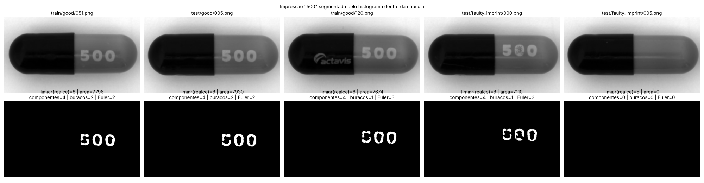
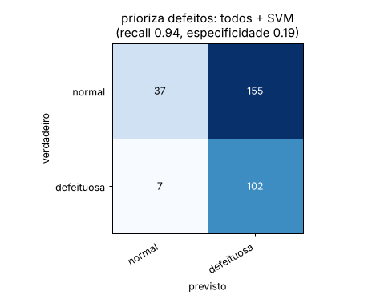
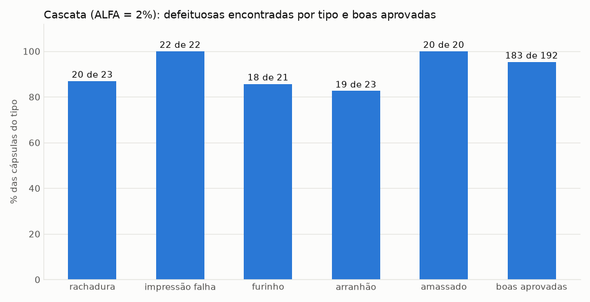
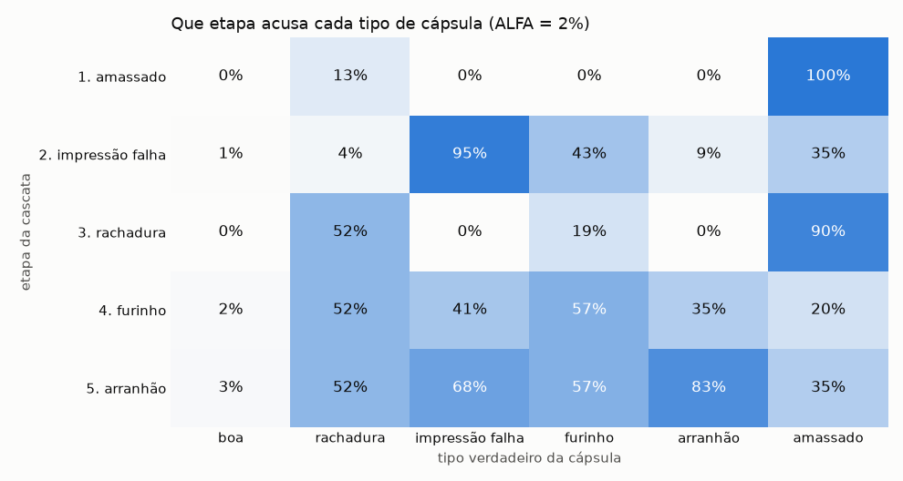

# Detecção e classificação de defeitos em cápsulas com processamento clássico de imagens

**Projeto 4 — Processamento Digital de Imagens (UFSCar) · Prof. Dr. Ricardo J. Ferrari**
Daniel e Murilo · base MVTec AD, categoria *capsule* · código em `src/`, resultados em `resultados/`

> Uso didático: partição própria; os números não são benchmark oficial do MVTec AD.

## Resumo

Investigamos se é possível detectar e classificar defeitos industriais usando apenas
processamento clássico de imagens e atributos interpretáveis. Na categoria *capsule* do MVTec AD,
comparamos duas estratégias de localização: bordas (Canny/Sobel) com morfologia, e diferença em
relação a uma cápsula boa de referência (*golden template*). O *golden template* venceu. Ele foi
aprimorado com a segmentação da impressão "500" e do logo pelo histograma e com o realinhamento
local dessas regiões. Em seguida, medimos o efeito de cada operação morfológica sobre os falsos
positivos, descrevemos a mancha mais suspeita de cada cápsula por 30 atributos (forma, textura,
posição/impressão) e classificamos com SVM e Random Forest em validação cruzada de 5 folds, sem
escolher parâmetros no conjunto de avaliação.

Resultados do método único (Etapas 1–5):
- a localização encontra **64%** das cápsulas defeituosas (Dice médio 0,155);
- a decisão normal × defeituosa atinge acurácia balanceada **0,70** (ROC-AUC 0,75);
- priorizando os defeitos, **94%** das defeituosas são encontradas, mas só 19% das boas são
  aprovadas;
- o tipo de defeito é identificado com acurácia balanceada **0,58** (acaso: 0,20).

Por orientação do professor, trocamos então o método único por **um método especialista para cada
defeito**, em cascata (Etapa 7): a cápsula passa por 5 etapas (amassado, impressão falha,
rachadura, furinho, arranhão) e só é aprovada se nenhuma acusar. Resultados da cascata, com os
limiares de decisão definidos só no treino de cada fold:
- **90%** das defeituosas encontradas com **96%** das boas aprovadas (acurácia balanceada
  **0,93**, ROC-AUC 0,98);
- priorizando os defeitos, **94%** das defeituosas com **90%** das boas aprovadas (antes: 19%);
- todas as cápsulas amassadas e com impressão falha são encontradas; o arranhão, que o método
  único não via (AUC 0,49), passa a ser separado das boas com AUC 0,98;
- a localização acerta **86%** das defeituosas (Dice 0,30).

A resposta à questão de projeto passa a ser **sim para detectar** e **parcialmente para dizer o
tipo**: cada defeito deixa uma marca diferente na imagem, e procurar cada marca com o método certo
funciona muito melhor que um método único. O que ainda limita é separar rachadura, furinho e
arranhão entre si (tipo apontado com acurácia balanceada 0,63) e a variação normal que restou
(logo cortado junto à borda).

## 1. Problema e questão de projeto

O objetivo é simular a inspeção visual automática de uma linha de produção. A partir da foto de uma
cápsula, o sistema deve **localizar** regiões anômalas, **descrevê-las** por atributos clássicos e
**classificar** a cápsula como normal/defeituosa e pelo tipo de defeito. A questão de projeto do
enunciado é:

> *É possível detectar e classificar defeitos usando apenas processamento clássico e atributos
> interpretáveis?*

Todas as técnicas de imagem usadas foram vistas em aula (filtros, Otsu, morfologia, bordas,
template matching, componentes conexos, descritores de forma, de histograma e LBP). Os
classificadores (SVM e Random Forest) e as métricas são os pedidos no enunciado. O alinhamento
global por ECC, herdado da primeira versão, é a exceção, declarada na seção 8.

## 2. Dados e partição

**Base:** MVTec AD, *capsule*. São imagens RGB de 1000×1000 px de uma cápsula preta/laranja com a
impressão "500" e o logo "actavis", sobre fundo claro.
- `train/good`: 219 normais;
- `test/good`: 23 normais;
- `test/<defeito>`: 109 defeituosas, sendo *crack* 23, *faulty_imprint* 22, *poke* 21, *scratch*
  23 e *squeeze* 20;
- cada defeituosa tem uma máscara de referência (*ground truth*).

**Partição própria** (`src/particao.py` → `dados/particao.csv`, semente 42):

| Conjunto | Imagens | Uso |
|---|---|---|
| `banco` | 30 normais (`train/good` 000–029) | referências do *golden template* |
| `calibracao` | 20 normais (`train/good` 030–049) | calibrar limiares e tamanhos, usando só a variação normal |
| `classificacao` | 192 normais + 109 defeituosas | avaliação da localização; atributos e classificação em validação cruzada de 5 folds estratificados por tipo |

Regra adotada: **quem ajusta não dá nota**. Nenhum limiar ou tamanho é escolhido olhando o conjunto
`classificacao`, e os hiperparâmetros dos classificadores são ajustados só no treino de cada rodada.
Na Etapa 7, o `banco` fornece as referências dos especialistas e os limiares de decisão seguem a
mesma regra (treino de cada rodada); o desenho dos especialistas é a exceção, declarada na seção 8.

## 3. Pipeline

Método único (Etapas 1–5):
```
imagem → cinza + bilateral → cápsula (Otsu) → golden template + realinhamento do "500"/logo
       → limiar calibrado → morfologia → manchas → ficha de 30 atributos → SVM / Random Forest
```
Cascata de especialistas (Etapa 7, seção 3.8):
```
imagem → 1. amassado → 2. impressão falha → 3. rachadura → 4. furinho → 5. arranhão → BOA
         (qualquer etapa que acuse encerra: DEFEITUOSA)
```

### 3.1 Pré-processamento e região de interesse
- Conversão para tons de cinza e **filtro bilateral** (d = 9, σ_cor = 40, σ_espaço = 9). Ele remove
  o ruído preservando o degrau dos defeitos finos; o Gaussiano espalharia o degrau, e a mediana
  apaga estruturas finas.
- **ROI da cápsula:** Otsu invertido (a cápsula é mais escura que o fundo), fechamento 15×15, maior
  componente conexo e erosão de 9 px para excluir o contorno, que acende por desalinhamento.

### 3.2 Localização: duas estratégias (Etapa 1)
- **A — bordas + morfologia:** Canny (15/40, histerese) e Sobel (|G| > 60), seguidos de abertura
  de 3 a 9 px.
- **B — golden template:** entre as 30 cápsulas do banco, escolhe-se a mais parecida com a testada
  (após o alinhamento global); a diferença |teste − referência| marca o que é anômalo.

### 3.3 Impressão e logo pelo histograma
Dentro da máscara da cápsula, o histograma tem modos separados: metade preta (< 45), logo (45–75),
metade laranja (75–112) e impressão (> 112). Como a iluminação deixa a metade laranja com dois tons,
o limiar é calculado no histograma do **realce local** (cinza − mediana 45×45), por Otsu: na metade
clara para o "500", na metade escura para o logo (com um contraste mínimo, porque o logo pode não
estar visível). Seguem abertura e componentes conexos com formato de algarismo ou letra
(`resultados/etapa4/impressao_500.png`).



### 3.4 Golden template com realinhamento local (Etapa 3)
A cápsula gira em torno do próprio eixo. Por isso, mesmo depois do alinhamento global, o "500" e o
logo aparecem alguns pixels deslocados em relação à referência. Na região dessas máscaras (no teste
e na referência), o deslocamento local é estimado por **template matching** (busca de ±20 px) e a
diferença é recalculada com a referência deslocada. A variação de posição desaparece, e uma falha
de impressão continua visível, porque altera a forma.

O **limiar** é o percentil 99 da diferença entre cápsulas boas (`calibracao` × `banco`): T = 27.

### 3.5 Morfologia (Etapa 3)
As operações são aplicadas de forma cumulativa, para medir o efeito de cada uma:
- C0: limiar;
- C1: abertura 5×5;
- C2: ROI erodida 9 px;
- C3: fechamento 5×5;
- C4: preenchimento de buracos;
- C5: remoção de componentes menores que A_MIN, com A_MIN = p95 da maior mancha nas boas de
  calibração (2.450 px).

A máscara **C4** segue para a etapa de atributos (justificativa na seção 5.2).

### 3.6 Atributos (Etapa 4)
Cada mancha com metade ou mais da área sobre o "500" ou o logo é tratada como variação normal. A
**mancha principal** é a maior entre as demais, ou seja, a mais suspeita. A ficha tem 30 atributos
em três grupos:

| Grupo | Atributos |
|---|---|
| Forma | nº de manchas, nº e área das suspeitas, área, perímetro, compacidade (P²/4πA), excentricidade, extensão, solidez, momentos de Hu 1–3 |
| Textura | média e desvio do cinza, média e máximo da diferença ao modelo, suavidade, assimetria, uniformidade e entropia do histograma, entropia e uniformidade do LBP |
| Posição e impressão | fração na metade preta, distância ao contorno, área de mancha sobre o "500" e sobre o logo, área relativa do "500", nº de componentes e de buracos do "500", variação de área entre algarismos |

### 3.7 Classificação (Etapa 5)
- **Tarefas:**
  - normal × defeituosa, nas 301 imagens;
  - qual defeito, nas 109 defeituosas.
- **Classificadores:** SVM (núcleo RBF, atributos padronizados) e Random Forest (300 árvores), com
  `class_weight='balanced'`. Hiperparâmetros por busca em grade com validação interna de 3 partes,
  dentro do treino de cada fold.
- **Ponto de operação "prioriza defeitos":** o limiar sobre a pontuação "defeituosa" é escolhido no
  treino de cada fold como o maior que ainda encontra ≥ 90% das defeituosas do treino.

### 3.8 Cascata de especialistas, um método por defeito (Etapa 7)

**Motivação.** O método único mede "diferença em relação a uma cápsula boa" e trata todo defeito
como uma mancha. Mas cada defeito deixa uma marca própria, e algumas delas quase não geram mancha
(arranhão) ou se confundem com a variação normal (impressão). A orientação do professor foi usar
um método para cada defeito, como já tinha sido feito com o "500", e aprovar a cápsula só se ela
passar por todos (`src/especialistas.py`, `src/cascata.py`).

Cada especialista devolve um número (quanto maior, mais suspeita) e a máscara do que acusou:

| # | Defeito | Marca na imagem | Método | Valor |
|---|---|---|---|---|
| 1 | amassado (*squeeze*) | a silhueta muda | máscara da cápsula (Otsu) × silhueta boa mais parecida: XOR + abertura 7×7 | área da maior região que sobra |
| 2 | impressão falha | o "500" muda | cada algarismo casado com o de cápsulas boas por correlação normalizada (*template matching*) | 1 − correlação do pior algarismo |
| 3 | rachadura (*crack*) | a tampa preta lasca e mostra o laranja, ou sai pó branco | segmentação preto × laranja pela cor (Otsu no a\* do Lab); tampa × tampa boa mais parecida, fora do "500": XOR + abertura 9×9 | área da maior região que sobra |
| 4 | furinho (*poke*) | mancha compacta com contraste local | *top-hat* e *black-hat* de 15 px acima do envelope, limiar 6, fechamento 5 + abertura 3 | área da maior mancha |
| 5 | arranhão (*scratch*) | feixe de riscos finos e claros (3–10 níveis) | *top-hat* de 9 px acima do envelope, limiar 3, sem o bilateral | pixels de fragmentos na janela 101×101 mais cheia |

- **Envelope das cápsulas boas** (especialistas 4 e 5). A cápsula boa também tem estruturas finas
  (linha de reflexo no meio, marca do molde, linhas internas), sempre no mesmo lugar. O envelope é
  o máximo do *top-hat* nas 30 boas do banco, dilatado 9 px para tolerar a posição; só o que passa
  dele conta.
- **Zona válida.** O que muda de lugar fica fora da busca dos especialistas 4 e 5: faixa de 13 px
  do contorno, o "500" dilatado (assunto do especialista 2), a divisa preto/laranja e o logo. O
  logo é segmentado como uma cadeia horizontal comprida de componentes claros (fechamento 45×15,
  largura ≥ 100 px), o que não apaga um furinho isolado na tampa preta.
- **Alinhamento.** A pose é estável na base (centro ±3 px, ângulo ±0,3°, tampa preta sempre à
  esquerda), então basta uma translação pelo centroide. A cascata não usa ECC.
- **Limiar de cada etapa**, definido só no treino: `a` = percentil (1 − ALFA) do valor nas boas
  (alarme falso aceito pela etapa); o limiar é o ponto médio entre `a` e o menor valor, acima de
  `a`, entre os defeitos-alvo. ALFA é o ponto de operação: 2% (padrão) ou 5% (prioriza defeitos).
- **Protocolo.** Referências: 30 boas do `banco`. Limiares: validação cruzada com os 5 folds
  (treino = 20 boas de `calibracao` + 4 folds; decisão no 5º).
- **Tipo apontado:** a primeira etapa que acusa, na ordem do mais específico (amassado, impressão)
  para o mais geral (furinho, arranhão).

## 4. Experimentos realizados (enunciado × onde está)

| Experimento mínimo | Onde |
|---|---|
| Comparar duas estratégias de localização | 5.1 (bordas × golden template) |
| Quantificar o efeito da morfologia sobre falsos positivos | 5.2 |
| Comparar atributos geométricos, de textura e a combinação completa | 5.4 (forma, textura, posição/impressão, todos) |
| Comparar pelo menos dois classificadores | 5.4 (SVM × Random Forest) |
| Separar resultados por tipo de defeito | 5.3 e 5.4 |
| Segmentação: Dice, IoU, precisão e recall pixel a pixel | 5.1 a 5.3 |
| Classificação: F1, acurácia balanceada, ROC-AUC | 5.4 |
| Exemplos de falsos positivos e falsos negativos | 6 |
| Etapas que mais limitam o desempenho | 7 |
| Um método por defeito (orientação do professor): candidatos, cascata, ablação | 5.5 |

A extensão opcional (atributos só da região defeituosa × atributos globais) não foi realizada.

## 5. Resultados

### 5.1 Bordas × golden template (Etapa 1, nas 132 imagens de `test/`)

Métricas:
- **hit:** fração de defeituosas com ≥ 30 px marcados dentro do *ground truth*;
- **FP/boa:** pixels marcados por cápsula boa;
- **precisão:** pixel a pixel.

| Estratégia | hit | FP/boa | Precisão |
|---|---:|---:|---:|
| Canny 15/40, sem abertura | 0,72 | 2.476 | 0,09 |
| Canny 15/40, abertura 3 | 0,42 | 247 | 0,24 |
| Canny 15/40, abertura 9 | 0,02 | 0 | 0,70 |
| **Golden template, limiar 30, abertura 5** | **0,63** | 2.792 | **0,31** |

As bordas não separam defeito de estrutura normal: a cápsula boa já é cheia de bordas (impressão,
logo, divisão das metades, contorno). A abertura que apaga essas bordas apaga os defeitos na mesma
proporção, porque rachaduras e arranhões também são finos. O golden template marca a **região** do
defeito, com precisão três vezes maior, e foi a estratégia adotada. (Nesta etapa, parâmetros e
avaliação usaram o mesmo `test/`; isso foi corrigido a partir da partição própria.)

### 5.2 Efeito da morfologia e do realinhamento (Etapa 3, 301 imagens de `classificacao`)

| Etapa (cumulativa) | hit | FP px/boa | Boas com alarme | Precisão | Dice | IoU |
|---|---:|---:|---:|---:|---:|---:|
| C0 limiar | 0,68 | 2.416 | 99% | 0,31 | 0,155 | 0,101 |
| C1 + abertura 5 | 0,65 | 1.905 | 86% | 0,34 | 0,159 | 0,106 |
| C2 + ROI erodida | 0,64 | 1.832 | 86% | 0,34 | 0,155 | 0,103 |
| C3 + fechamento | 0,64 | 1.856 | 86% | 0,34 | 0,156 | 0,104 |
| **C4 + preenchimento** | **0,64** | **1.913** | **86%** | **0,34** | **0,155** | **0,104** |
| C5 + remove < 2.450 px | 0,17 | 568 | 10% | 0,45 | 0,058 | 0,042 |


- A **abertura** é a operação que mais reduz falsos positivos (boas com alarme: 99% → 86%). ROI
  erodida, fechamento e preenchimento quase não mudam os números, mas deixam as manchas sólidas
  para a descrição.
- A **remoção por área** elimina quase todos os alarmes e quase todos os defeitos: as manchas falsas
  das boas têm o tamanho dos defeitos. Por isso seguimos com **C4**.
- O **realinhamento local do "500" e do logo** reduziu a variação normal (o limiar calibrado caiu de
  32 para 27) e melhorou a localização:

| Máscara C4 | hit | FP px/boa | Dice | hit *crack* | hit *faulty_imprint* |
|---|---:|---:|---:|---:|---:|
| sem realinhamento | 0,57 | 2.398 | 0,126 | 0,65 | 0,59 |
| com realinhamento | **0,64** | **1.913** | **0,155** | **0,83** | **0,82** |

### 5.3 Localização por tipo de defeito (máscara final C4)

| Tipo | hit | Precisão | Recall | Dice | IoU |
|---|---:|---:|---:|---:|---:|
| *crack* | 0,83 | 0,51 | 0,22 | 0,246 | 0,176 |
| *faulty_imprint* | 0,82 | 0,14 | 0,08 | 0,082 | 0,044 |
| *poke* | 0,67 | 0,44 | 0,18 | 0,229 | 0,161 |
| *scratch* | 0,00 | 0,00 | 0,00 | 0,000 | 0,000 |
| *squeeze* | 0,95 | 0,40 | 0,25 | 0,233 | 0,145 |

As manchas são parciais (recall pixel a pixel ≤ 0,25): o método marca pedaços do defeito (bordas
do *poke*, extremidades do *squeeze*), o que basta para "achar" a cápsula, mas não para delinear o
defeito. O *scratch* é fino e de baixo contraste demais para a diferença ao modelo.


### 5.4 Classificação (Etapa 5)

**Normal × defeituosa** (301 imagens; acaso: acurácia balanceada 0,50):

| Grupo | SVM: acur. bal. / F1 / AUC | Random Forest: acur. bal. / F1 / AUC |
|---|---|---|
| forma | 0,59 / 0,33 / 0,64 | 0,64 / 0,53 / 0,65 |
| textura | 0,58 / 0,45 / 0,65 | 0,59 / 0,45 / 0,63 |
| posição/impressão | 0,66 / 0,55 / 0,69 | 0,70 / 0,60 / 0,74 |
| **todos** | **0,70 / 0,60 / 0,75** | 0,70 / 0,60 / 0,75 |

Com a decisão padrão (todos + RF): precisão 0,70, recall 0,52, especificidade 0,87.

**Priorizando os defeitos** (limiar escolhido no treino para recall ≥ 90%):

| Grupo | SVM: recall / especificidade | Random Forest: recall / especificidade |
|---|---|---|
| forma | 0,91 / 0,13 | 0,94 / 0,06 |
| textura | 0,92 / 0,21 | 0,95 / 0,12 |
| posição/impressão | 0,92 / 0,18 | 0,94 / 0,18 |
| **todos** | **0,94 / 0,19** | 0,94 / 0,19 |

Todos + SVM encontra 102 das 109 defeituosas (*crack* 21/23, *faulty_imprint* 22/22, *poke* 19/21,
*scratch* 21/23, *squeeze* 19/20), aprovando 37 das 192 boas.



**Qual defeito** (109 defeituosas; acaso: 0,20):

| Grupo | SVM: acur. bal. / F1 macro | Random Forest: acur. bal. / F1 macro |
|---|---|---|
| forma | 0,39 / 0,39 | 0,38 / 0,38 |
| textura | 0,53 / 0,53 | 0,45 / 0,43 |
| posição/impressão | 0,33 / 0,34 | 0,50 / 0,49 |
| **todos** | 0,55 / 0,54 | **0,58 / 0,57** |

Acerto por tipo (todos + RF): *squeeze* 0,90, *faulty_imprint* 0,86, *crack* 0,43, *scratch*
0,43, *poke* 0,29.


- **A combinação completa** é a melhor nas duas tarefas. Nenhum grupo sozinho chega lá.
- Na decisão normal × defeituosa, o grupo **posição/impressão** sozinho chega perto do total; para
  o tipo, **textura** e **forma** pesam mais. Os atributos mais usados pelo Random Forest são área e
  perímetro da mancha suspeita, área relativa do "500", diferença média ao modelo e variação de área
  entre algarismos (`importancia_atributos.png`).
- **SVM × Random Forest:** desempenho equivalente na decisão normal × defeituosa; o Random Forest é
  melhor para o tipo de defeito.

### 5.5 Cascata de especialistas (Etapa 7)

**Qual método para cada defeito** (`src/comparar_candidatos.py` →
`resultados/etapa7/tabela_candidatos.txt`). AUC do defeito-alvo contra as boas; "achadas" é a
fração do defeito-alvo acima do percentil 98 das boas de treino (5 folds):

| Defeito | Método | AUC | Achadas |
|---|---|---:|---:|
| amassado | método único (maior mancha do golden template) | 0,992 | 0,95 |
| | descritores globais da silhueta | 0,993 | 0,95 |
| | **XOR com a silhueta boa mais parecida + abertura** | **1,000** | **1,00** |
| impressão falha | método único | 0,666 | 0,05 |
| | desvio da área do "500" (Etapa 4) | 0,817 | 0,36 |
| | correlação do "500" inteiro | 0,999 | 0,95 |
| | **correlação do pior algarismo** | **1,000** | **1,00** |
| rachadura | método único | 0,726 | 0,26 |
| | forma da tampa preta, Otsu no cinza | 0,636 | 0,13 |
| | **forma da tampa preta, Otsu no a\*** | **0,773** | **0,52** |
| | contraste local 15 px (especialista do furinho) | 0,935 | 0,57 |
| furinho | método único | 0,562 | 0,05 |
| | top-hat/black-hat 15 px, sem envelope | 0,751 | 0,00 |
| | top-hat/black-hat 25 px, acima do envelope | 0,906 | 0,57 |
| | **top-hat/black-hat 15 px, acima do envelope** | **0,967** | **0,62** |
| arranhão | método único | 0,492 | 0,00 |
| | pixels de borda do Canny (Etapa 1) | 0,526 | 0,04 |
| | maior risco (top-hat 9 px), acima do envelope | 0,961 | 0,61 |
| | concentração de fragmentos, sem envelope | 0,934 | 0,30 |
| | **concentração de fragmentos, acima do envelope** | **0,983** | **0,87** |

- O envelope é decisivo: o mesmo top-hat sem ele acha 0% dos furinhos e 30% dos arranhões.
- No arranhão, o risco sai picotado pelo limiar baixo; a concentração de fragmentos diz mais que
  o maior pedaço.
- Na rachadura, o contraste local tem AUC maior, mas ele já é a etapa 4. A forma da tampa foi
  mantida como etapa 3 porque acha as lascas, que quase não têm contraste local.

**Normal × defeituosa** (`tabela_cascata.txt`; 301 imagens, 5 folds):

| ALFA | Boas aprovadas | Defeituosas encontradas | Acur. bal. | Precisão | crack / imprint / poke / scratch / squeeze |
|---|---:|---:|---:|---:|---|
| 1% | 0,98 | 0,88 | 0,93 | 0,96 | 0,83 / 0,95 / 0,86 / 0,78 / 1,00 |
| **2% (padrão)** | **0,96** (185/192) | **0,90** (98/109) | **0,93** | **0,93** | 0,83 / 1,00 / 0,86 / 0,83 / 1,00 |
| 3% | 0,94 | 0,93 | 0,93 | 0,89 | 0,87 / 1,00 / 0,90 / 0,87 / 1,00 |
| **5% (prioriza defeitos)** | **0,90** | **0,94** (103/109) | **0,92** | 0,84 | 0,96 / 1,00 / 0,90 / 0,87 / 1,00 |
| 8% | 0,86 | 0,98 | 0,92 | 0,80 | 1,00 / 1,00 / 0,95 / 0,96 / 1,00 |

ROC-AUC da cascata: 0,98 (método único: 0,75).




**Que etapa acusa cada tipo** (ALFA = 2%):



- Amassado e impressão são específicos: quase só acusam o próprio defeito (a impressão também
  acusa furinhos e arranhões que caem sobre o "500").
- Furinho e arranhão medem contraste local e reagem a quase todos os defeitos.
- **Tipo apontado** (primeira etapa que acusa): acurácia balanceada **0,63** nas 5 classes,
  contando defeituosa não achada como erro. Por tipo: amassado 1,00, impressão falha 0,95,
  rachadura 0,43, arranhão 0,43, furinho 0,33.

**Ablação** (`ablacao.txt`, ALFA = 2%):

| Configuração | Boas aprovadas | Defeituosas encontradas | O que se perde |
|---|---:|---:|---|
| cascata completa | 0,96 | 0,90 | — |
| sem amassado | 0,96 | 0,87 | 2 amassados e 1 rachadura |
| sem impressão falha | 0,97 | 0,80 | 7 impressões falhas e 4 furinhos |
| sem rachadura | 0,96 | 0,85 | 5 rachaduras |
| sem furinho | 0,97 | 0,90 | nenhuma cápsula |
| sem arranhão | 0,98 | 0,80 | 10 arranhões e 1 impressão falha |

O especialista do furinho é redundante neste ponto de operação: os furinhos que ele acha também
são achados pelos do arranhão e da impressão.

**Localização** (`localizacao.txt`; união das máscaras das etapas que acusaram × ground truth):

| | hit | Precisão | Dice | FP px/boa | Boas com pixel marcado |
|---|---:|---:|---:|---:|---:|
| método único (C4, Etapa 3) | 0,64 | 0,34 | 0,155 | 1.913 | 86% |
| **cascata (ALFA = 2%)** | **0,86** | **0,53** | **0,295** | **20** | **4%** |

Por tipo (hit / Dice): rachadura 0,83 / 0,37; impressão falha 0,95 / 0,33; furinho 0,71 / 0,31;
arranhão 0,83 / 0,20; amassado 1,00 / 0,26.


## 6. Exemplos de erros


- **Falsos positivos** (boas rejeitadas): manchas sobre o logo **parcialmente visível** (quando a
  cápsula gira, o logo aparece cortado e o realinhamento não reproduz a forma), reflexos e contorno.
  Em algumas, a mancha é mínima e a decisão vem dos atributos da impressão.
- **Falsos negativos** (defeituosas aprovadas): defeitos que viraram **manchas pequenas**: rachadura
  e furinho com poucos pixels marcados, e *squeeze* cuja deformação fica na faixa da borda excluída
  pela ROI erodida.
- A lista completa de erros está em `resultados/etapa5/erros_binaria.csv`.

**Cascata (Etapa 7, ALFA = 2%)**: 7 boas rejeitadas e 11 defeituosas aprovadas
(`resultados/etapa7/erros.csv`).


- **Falsos positivos:** nos casos conferidos (`train/good/064` e `084`), o logo aparece **cortado
  junto à borda**; a regra da cadeia comprida não o reconhece e ele é acusado como furinho ou
  arranhão.
- **Falsos negativos:** 4 rachaduras, 4 arranhões e 3 furinhos de baixo contraste, ou junto à
  divisa e ao contorno, que ficam fora da zona válida.

## 7. Discussão: o que mais limita o desempenho

Os itens 1 a 5 referem-se ao método único (Etapas 1–5); o item 6, à cascata.

1. **Localização (parte 1) é o gargalo principal.** A classificação só reconhece o que a localização
   marcou. Melhorar a localização (hit 0,57 → 0,64) aumentou o acerto do tipo (0,53 → 0,58), mas não
   a decisão normal × defeituosa, que ficou em ≈ 0,70 em todas as versões. Mesmo após o
   realinhamento, ≈ 75% das cápsulas boas ainda têm alguma mancha suspeita fora do "500" e do logo,
   parecida com as manchas pequenas de rachaduras e arranhões.
2. **Variação natural da cápsula boa.** A rotação em torno do próprio eixo muda a posição do "500"
   e a visibilidade do logo. Nenhuma transformação 2D global corrige isso. O realinhamento local
   resolveu quase todo o problema do "500" (≈ 3% dos pixels falsos restantes), mas não o do logo
   parcialmente visível (≈ 76%).
3. **Defeitos finos e de baixo contraste.** O *scratch* tem Dice ≈ 0 em todas as versões: a
   diferença que ele causa está abaixo da variação normal medida na calibração.
4. **Trade-off precisão × recall.** Achar ≥ 90% dos defeitos custa rejeitar ~80% das boas. Com a
   decisão padrão, aprova-se 87% das boas, mas só metade dos defeitos é encontrada.
5. **Poucos exemplos por classe** (~20 por defeito): diferenças de até ±0,05 entre configurações
   estão dentro da variação esperada.
6. **Cascata de especialistas (Etapa 7).** Procurar a marca de cada defeito com um método próprio
   remove o gargalo da localização: a acurácia balanceada vai de 0,70 para 0,93, e o arranhão
   deixa de ser invisível. O que passa a limitar é:
   - **dizer o tipo:** furinho e arranhão medem contraste local e reagem a quase todos os
     defeitos; rachadura, furinho e arranhão se confundem (tipo apontado: 0,63);
   - **defeitos de baixo contraste** e os que ficam junto à divisa ou ao contorno (fora da zona
     válida);
   - **o logo cortado junto à borda**, que continua sendo a variação normal mais difícil.

## 8. Limitações e escolhas declaradas

- **ECC:** o alinhamento global usa ECC (modelo euclidiano), que não foi visto em aula. O
  realinhamento local usa template matching.
- **Etapa 1:** parâmetros e avaliação no mesmo `test/` (corrigido a partir da Etapa 2).
- **Escolhas feitas depois de ver resultados no conjunto `classificacao`**, cada uma rodada uma
  única vez:
  - usar C4 em vez de C5;
  - acrescentar o realinhamento do "500"/logo;
  - descrever a mancha principal fora do "500"/logo.

  As duas últimas foram motivadas por diagnóstico (onde estavam os pixels falsos). Ainda assim, os
  números finais podem estar levemente otimistas.
- **Etapa 7: os especialistas foram desenhados olhando as imagens de `classificacao`**, porque
  todas as defeituosas estão nesse conjunto: a marca procurada em cada defeito, as zonas excluídas
  (incluindo tirar o "500" da comparação da tampa, feito depois de ver 3 alarmes falsos), os
  tamanhos dos elementos estruturantes e os limiares internos (6 e 3 níveis, janela de 101 px). Só
  os limiares de decisão das etapas são definidos em validação cruzada. Os números da Etapa 7 são,
  portanto, otimistas; uma estimativa isenta exigiria cápsulas novas.
- A Etapa 7 supõe a pose da base (tampa preta à esquerda, cápsula horizontal e centrada).
- **GLCM** (citada no enunciado) não foi usada, porque não foi vista em aula. A textura é descrita
  por estatísticas do histograma e LBP.
- Avaliação **didática**, em partição própria; não é benchmark oficial do MVTec AD.

## 9. Conclusão

É possível **detectar** defeitos de cápsulas apenas com processamento clássico, desde que cada
defeito seja procurado pela marca que deixa na imagem:
- com um **método único** (golden template + atributos + classificador), a decisão normal ×
  defeituosa ficou em 0,70 de acurácia balanceada, e achar 94% dos defeitos custava rejeitar 81%
  das boas;
- com a **cascata de especialistas** (silhueta, correlação dos algarismos, cor da tampa, contraste
  local e riscos finos), a acurácia balanceada chega a 0,93: 90% das defeituosas encontradas com
  96% das boas aprovadas, ou 94% com 90%;
- amassado e impressão falha são encontrados em todas as cápsulas; rachadura, furinho e arranhão,
  em 83% a 86%.

**Classificar o tipo** continua parcial (0,63): os especialistas de contraste local não são
exclusivos, e rachadura, furinho e arranhão se confundem. Os próximos passos naturais são casar o
logo com modelos de cápsulas boas (como foi feito com o "500"), para tratar o logo cortado junto à
borda, e descrever a região acusada por atributos de forma e textura para separar melhor esses
três defeitos. Como os especialistas foram desenhados olhando o mesmo conjunto em que são
avaliados, os números da cascata devem ser confirmados em cápsulas novas.

## Referências

- Bergmann, P. et al. *MVTec AD — A Comprehensive Real-World Dataset for Unsupervised Anomaly
  Detection.* CVPR, 2019.
- Otsu, N. *A Threshold Selection Method from Gray-Level Histograms.* IEEE Trans. SMC, 1979.
- Canny, J. *A Computational Approach to Edge Detection.* IEEE Trans. PAMI, 1986.
- Tomasi, C.; Manduchi, R. *Bilateral Filtering for Gray and Color Images.* ICCV, 1998.
- Ojala, T.; Pietikäinen, M.; Mäenpää, T. *Multiresolution Gray-Scale and Rotation Invariant
  Texture Classification with Local Binary Patterns.* IEEE Trans. PAMI, 2002.
- Hu, M.-K. *Visual Pattern Recognition by Moment Invariants.* IRE Trans. Information Theory, 1962.
- Cortes, C.; Vapnik, V. *Support-Vector Networks.* Machine Learning, 1995.
- Breiman, L. *Random Forests.* Machine Learning, 2001.
- Gonzalez, R. C.; Woods, R. E. *Processamento Digital de Imagens.* Pearson. (morfologia em tons
  de cinza: *top-hat* e *black-hat*; casamento por correlação.)
