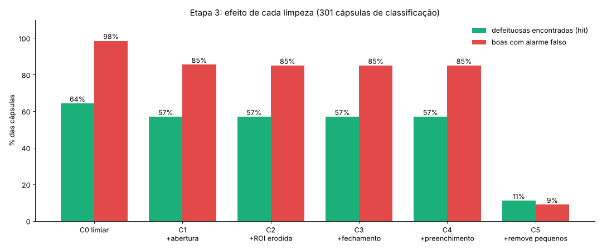
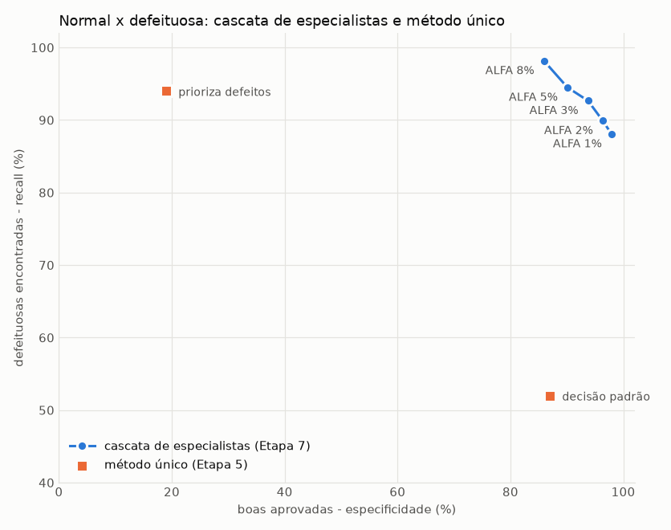

# Detecção e classificação de defeitos em cápsulas com processamento clássico de imagens

**Projeto 4 — Processamento Digital de Imagens (UFSCar) · Prof. Dr. Ricardo J. Ferrari**
Daniel e Murilo · base MVTec AD, categoria *capsule* · código em `src/`, resultados em `resultados/`

> Uso didático: partição própria; os números não são benchmark oficial do MVTec AD.

## Resumo

A questão de projeto é se dá para **detectar e classificar** defeitos industriais usando apenas
processamento clássico de imagens e atributos interpretáveis. Trabalhamos com a categoria *capsule*
do MVTec AD e a arquitetura passou por duas fases:

1. **Método único** (Etapas 1–5): comparar a cápsula com uma cápsula boa de referência (*golden
   template*), limpar a diferença com morfologia, descrever a mancha mais suspeita por 30 atributos
   e classificar com SVM e Random Forest. Resultado: acurácia balanceada **0,70** na decisão
   normal × defeituosa e **0,58** no tipo de defeito.
2. **Cascata de especialistas** (Etapa 7, versão final): um método para cada defeito, procurando a
   marca que ele deixa na imagem; a cápsula só é aprovada se nenhum acusar. Resultado: **91%** das
   defeituosas encontradas com **95%** das boas aprovadas (acurácia balanceada **0,93**, ROC-AUC
   0,97) e tipo apontado com acurácia balanceada **0,71**.

A resposta é **sim para detectar** e **parcialmente para dizer o tipo**. A lição central do projeto
é que o gargalo não estava no classificador, e sim em **onde e como se procura o defeito**: trocar
um detector genérico por detectores específicos levou a decisão de 0,70 para 0,93, enquanto trocar
de classificador (SVM, Random Forest ou limiares) nunca mudou essa decisão em mais de 0,01.

## 1. Dados e protocolo

**Base.** Imagens RGB de 1000×1000 px de uma cápsula preta e laranja com a impressão "500" e o logo
"actavis", sobre fundo claro. São 242 cápsulas boas (219 em `train/good`, 23 em `test/good`) e 109
defeituosas de 5 tipos: rachadura (*crack*, 23), impressão falha (*faulty_imprint*, 22), furinho
(*poke*, 21), arranhão (*scratch*, 23) e amassado (*squeeze*, 20). Cada defeituosa tem uma máscara
de referência (*ground truth*), usada só para avaliar.

**Partição própria** (`src/particao.py`, semente 42):

| Conjunto | Imagens | Uso |
|---|---|---|
| `banco` | 30 boas | referências (modelos de cápsula boa) |
| `calibracao` | 20 boas | medir a variação normal e calibrar limiares |
| `classificacao` | 192 boas + 109 defeituosas | avaliação, em validação cruzada de 5 folds estratificados por tipo |

**Regra adotada: quem ajusta não dá nota.** Limiares e tamanhos vêm de `calibracao` ou do treino de
cada fold; cada imagem de `classificacao` é decidida por parâmetros que não a viram. A exceção (o
desenho dos especialistas) está declarada na seção 6.

**Métricas.** Na localização, pixel a pixel contra o *ground truth*: precisão, Dice, *hit* (fração
das defeituosas com ≥ 30 px marcados dentro do defeito) e pixels falsos por cápsula boa. Na
decisão: acurácia balanceada (acaso = 0,50; 0,20 para os 5 tipos), F1 e ROC-AUC.

## 2. Evolução da arquitetura

```
v1  bordas (Canny/Sobel)  ×  golden template                     → golden template vence
v2  golden template + morfologia + realinhamento do "500"/logo    → hit 0,64, mas 86% das boas com alarme
v3  v2 + ficha de 30 atributos + SVM / Random Forest              → decisão 0,70; tipo 0,58
v4  cascata: um especialista por defeito                          → decisão 0,93; tipo 0,63
v5  v4 + furinho por forma (LoG) + tipo refinado pelo "500"       → decisão 0,93; tipo 0,71
```

### 2.1 v1 — Bordas × golden template (Etapa 1)

Pré-processamento comum: tons de cinza e filtro bilateral (suaviza o ruído sem espalhar o degrau
dos defeitos finos); região da cápsula por Otsu invertido, fechamento, maior componente e erosão de
9 px para excluir o contorno.

- **A — bordas:** Canny (15/40) e Sobel, seguidos de abertura de 3 a 9 px.
- **B — golden template:** escolhe-se, entre as 30 boas do banco, a mais parecida com a testada
  (alinhamento global por ECC) e marca-se |teste − referência| acima de um limiar.

| Estratégia (132 imagens de `test/`) | hit | Pixels falsos por boa | Precisão |
|---|---:|---:|---:|
| Canny, sem abertura | 0,72 | 2.476 | 0,09 |
| Canny, abertura 3 | 0,42 | 247 | 0,24 |
| Canny, abertura 9 | 0,02 | 0 | 0,70 |
| **Golden template, limiar 30, abertura 5** | **0,63** | 2.792 | **0,31** |

**Decisão:** bordas não separam defeito de estrutura normal. A cápsula boa já é cheia de bordas
("500", logo, divisa das metades, contorno), e a abertura que as apaga apaga junto rachaduras e
arranhões, que também são finos. O golden template marca a **região** do defeito com o triplo da
precisão e foi adotado.

### 2.2 v2 — Golden template limpo (Etapas 2–3)

Dois problemas apareceram ao rodar o golden template na partição própria:

1. **O "500" e o logo acendem sempre.** A cápsula gira em torno do próprio eixo, e a impressão
   aparece alguns pixels deslocada em relação à referência. Solução: segmentar o "500" e o logo
   pelo histograma do **realce local** (cinza − mediana 45×45, limiar de Otsu) e, nessas regiões,
   **realinhar** a referência por *template matching* (busca de ±20 px) antes de subtrair. A
   variação de posição some; uma falha de impressão continua visível, porque muda a forma.
2. **Manchas soltas.** Medimos o efeito de cada operação morfológica, de forma cumulativa, nas 301
   imagens de `classificacao` (limiar T = 27, percentil 99 da diferença entre boas):

| Máscara | hit | Pixels falsos por boa | Boas com alarme | Precisão | Dice |
|---|---:|---:|---:|---:|---:|
| C0 limiar | 0,68 | 2.416 | 99% | 0,31 | 0,155 |
| C1 + abertura 5×5 | 0,65 | 1.905 | 86% | 0,34 | 0,159 |
| C2–C4 + ROI erodida, fechamento, preenchimento | 0,64 | 1.913 | 86% | 0,34 | 0,155 |
| C5 + remove manchas < 2.450 px | 0,17 | 568 | 10% | 0,45 | 0,058 |



**Decisões:**
- A **abertura** é a única operação que reduz os alarmes de forma útil (99% → 86% das boas).
- **Remover manchas pequenas é inviável:** as manchas falsas das boas têm o tamanho dos defeitos, e
  o filtro por área leva os dois juntos (hit 0,64 → 0,17). Seguimos com **C4** e deixamos a
  separação para a etapa de atributos.
- O **realinhamento** valeu a pena: hit 0,57 → 0,64, impressão falha 0,59 → 0,82, rachadura
  0,65 → 0,83, e o limiar calibrado caiu de 32 para 27 (menos variação normal).
- O arranhão continua invisível (hit 0): a diferença que ele causa fica abaixo da variação normal.

### 2.3 v3 — Atributos e classificador (Etapas 4–5)

Cada cápsula vira uma **ficha de 30 atributos** da mancha mais suspeita (a maior fora do "500" e do
logo): forma (área, perímetro, compacidade, excentricidade, solidez, momentos de Hu), textura
(estatísticas do histograma e LBP) e posição/impressão (onde a mancha está, área e nº de buracos do
"500"). SVM (RBF) e Random Forest (300 árvores), hiperparâmetros só no treino de cada fold.

| Tarefa (todos os atributos) | SVM | Random Forest |
|---|---:|---:|
| Normal × defeituosa: acurácia balanceada / ROC-AUC | 0,70 / 0,75 | 0,70 / 0,75 |
| Priorizando defeitos (recall ≥ 90% no treino): recall / boas aprovadas | 0,94 / 0,19 | 0,94 / 0,19 |
| Tipo de defeito: acurácia balanceada | 0,55 | 0,58 |

- A combinação dos três grupos é melhor que qualquer grupo sozinho, e SVM e Random Forest empatam
  na detecção.
- **O limite da arquitetura:** mesmo com o realinhamento, ≈ 75% das cápsulas boas ainda têm alguma
  mancha suspeita fora do "500" e do logo (logo cortado, reflexos, contorno), parecida com as
  manchas pequenas de rachaduras e furinhos. Achar 94% dos defeitos custava rejeitar 81% das boas.
- Melhorar a localização (v2) subiu o tipo de 0,53 para 0,58, mas não moveu a decisão normal ×
  defeituosa, que ficou em ≈ 0,70 em todas as versões. **O classificador só reconhece o que a
  localização marcou**, e uma pergunta genérica ("o que difere da cápsula boa?") não separa defeito
  de variação normal.

### 2.4 v4 — Cascata de especialistas (Etapa 7)

Cada defeito deixa uma marca própria; alguns quase não geram mancha (arranhão) ou se confundem com a
variação normal (impressão). Por orientação do professor, a arquitetura passou a ter **um
especialista por defeito**, cada um medindo só a marca do seu defeito e devolvendo um número (quanto
maior, mais suspeita) e a máscara do que acusou:

```
imagem → 1. amassado → 2. impressão falha → 3. rachadura → 4. furinho → 5. arranhão → BOA
          (qualquer etapa que acuse encerra: DEFEITUOSA; o tipo é o da primeira que acusa)
```

| # | Defeito | Marca na imagem | Método | Valor |
|---|---|---|---|---|
| 1 | amassado | a silhueta muda | silhueta (Otsu) XOR silhueta boa mais parecida, abertura 7×7 | área da maior região que sobra |
| 2 | impressão falha | o "500" muda | cada algarismo casado com os das boas por correlação normalizada | 1 − correlação do pior algarismo |
| 3 | rachadura | a tampa preta lasca e mostra o laranja | tampa segmentada pela cor (Otsu no canal a\* do Lab) XOR tampa boa mais parecida, fora do "500", abertura 9×9 | área da maior região que sobra |
| 4 | furinho | mancha compacta e arredondada | LoG em 3 escalas acima do envelope; Otsu num círculo em volta de cada pico; circularidade (seção 2.5) | resposta do LoG × circularidade |
| 5 | arranhão | feixe de riscos finos e claros | *top-hat* de 9 px acima do envelope, limiar baixo | fragmentos na janela de 101×101 px mais cheia |

Três peças tornam os especialistas de contraste local viáveis:
- **Envelope das boas.** A cápsula boa também tem estruturas finas (reflexo no meio, marca do molde)
  sempre no mesmo lugar. O envelope é o máximo da resposta nas 30 boas do banco, dilatado 9 px; só o
  que passa dele conta. Sem o envelope, o mesmo *top-hat* acha 0% dos furinhos e 30% dos arranhões.
- **Zona válida.** O que muda de lugar (contorno, "500", divisa preto/laranja, logo) fica fora da
  busca dos especialistas 4 e 5.
- **Alinhamento simples.** A pose é estável na base (centro ±3 px, ângulo ±0,3°), então basta uma
  translação pelo centroide; a cascata não usa o ECC.

**Limiar de cada etapa (o ponto de operação).** `a` = percentil (1 − ALFA) do valor nas boas de
treino, ou seja, a etapa aceita no máximo ALFA de alarme falso; o limiar é o ponto médio entre `a`
e o menor defeito-alvo acima dele. ALFA = 2% é o padrão; 5% prioriza defeitos. Tudo em validação
cruzada.

**Como cada método foi escolhido.** Para cada defeito comparamos de 3 a 7 candidatos pelo AUC do
defeito-alvo contra as boas (`resultados/etapa7/tabela_candidatos.txt`). O ganho sobre o método
único é maior justamente onde ele falhava:

| Defeito | Método único (AUC) | Especialista escolhido (AUC) |
|---|---:|---:|
| amassado | 0,992 | **1,000** |
| impressão falha | 0,666 | **1,000** |
| rachadura | 0,726 | **0,773** |
| furinho | 0,562 | **0,817** |
| arranhão | 0,492 | **0,983** |

### 2.5 v5 — Furinho pela forma e tipo refinado (Etapa 7)

**Problema.** Na v4 o furinho media só contraste local (*top-hat*/*black-hat* de 15 px). Como
arranhões, impressões falhas e rachaduras também têm contraste local, a etapa acusava todos eles e
era **redundante**: tirá-la da cascata não perdia nenhuma defeituosa. O tipo apontado ficava em 0,63.

**Solução: medir a forma.** O que distingue o furo é ser uma mancha **compacta**, e não um risco:
1. **Laplaciano da Gaussiana** (σ = 6, 9 e 13 px), acima do envelope: responde forte no centro de
   manchas arredondadas do tamanho do furo e fraco a riscos finos;
2. **Otsu num círculo** de raio 3σ em volta de cada pico: separa a mancha da vizinhança dela;
3. **Circularidade** 4πA/P² da região e área mínima de 150 px (tira os pontos de poeira).


**Refinamento do tipo.** Furinhos sobre o "500" eram acusados primeiro pela etapa da impressão
(9 de 21 saíam como "impressão falha"). O sinal da diferença distingue os dois: na impressão falha
**falta tinta** (a cápsula fica mais escura que o modelo), e o furo expõe material **mais claro**.
Quando a etapa 2 é a primeira a acusar e a fração clara passa de um corte aprendido no treino, o
tipo é furinho.

| Etapa do furinho (ALFA = 2%) | Arranhões acusados | Impressões acusadas | Acur. bal. | Tipo apontado |
|---|---:|---:|---:|---:|
| contraste local (v4) | 8 | 9 | 0,93 | 0,63 |
| LoG + Otsu no círculo + circularidade | **1** | **1** | 0,93 | 0,67 |
| + refinamento pela diferença do "500" (v5) | 1 | 1 | 0,93 | **0,71** |

A etapa deixou de ser redundante, o acerto do arranhão subiu de 0,43 para 0,70 e o do furinho, de
0,33 para 0,52, sem mudar a decisão normal × defeituosa. O custo é que os alarmes falsos do furinho
não coincidem mais com os do arranhão: a cascata rejeita 2 boas a mais em ALFA = 2%.

## 3. Resultados da versão final

### 3.1 Normal × defeituosa

| ALFA | Boas aprovadas | Defeituosas encontradas | Acur. bal. | Precisão | rachadura / impressão / furinho / arranhão / amassado |
|---|---:|---:|---:|---:|---|
| 1% | 0,98 | 0,89 | 0,93 | 0,96 | 0,87 / 0,95 / 0,86 / 0,78 / 1,00 |
| **2% (padrão)** | **0,95** (183/192) | **0,91** (99/109) | **0,93** | **0,92** | 0,87 / 1,00 / 0,86 / 0,83 / 1,00 |
| **5% (prioriza defeitos)** | **0,87** (167/192) | **0,94** (103/109) | **0,91** | 0,80 | 0,91 / 1,00 / 0,95 / 0,87 / 1,00 |
| 8% | 0,83 | 0,95 | 0,89 | 0,76 | 0,91 / 1,00 / 0,95 / 0,91 / 1,00 |

ROC-AUC da cascata: **0,97** (método único: 0,75). Para achar 94% dos defeitos, o método único
aprovava 19% das boas; a cascata aprova 87%.



**Contribuição de cada etapa** (ablação em ALFA = 2%): sem o arranhão, a cascata cai de 0,91 para
0,73 das defeituosas encontradas (perde 16 arranhões); sem a impressão, para 0,80; sem o amassado,
a rachadura ou o furinho, perde 1 ou 2 cápsulas cada. Amassado e impressão são etapas específicas
(quase só acusam o próprio defeito); o arranhão mede contraste fino e reage a quase todos.

### 3.2 Localização

| Arquitetura | hit | Precisão | Dice | Pixels falsos por boa | Boas com pixel marcado |
|---|---:|---:|---:|---:|---:|
| método único (C4) | 0,64 | 0,34 | 0,155 | 1.913 | 86% |
| **cascata (ALFA = 2%)** | **0,87** | **0,53** | **0,292** | **19** | **5%** |

A máscara da cascata é a união das máscaras das etapas que acusaram. A **abertura** continua sendo a
operação morfológica decisiva: nos especialistas que comparam formas por XOR, ela remove a casca
fina que sobra entre duas cápsulas boas e leva os pixels falsos por boa de 1.985 para 19 (amassado)
e de 3.261 para 3 (rachadura).


### 3.3 Tipo de defeito

| Quem dá o tipo (a cascata decide normal × defeituosa) | Acur. bal. (5 classes) | Tipo certo entre as achadas | rachadura / impressão / furinho / arranhão / amassado |
|---|---:|---:|---|
| 1ª etapa que acusa | 0,67 | 74% | 0,43 / 0,95 / 0,29 / 0,70 / 1,00 |
| **1ª etapa + diferença do "500" (adotada)** | **0,71** | **78%** | 0,43 / 0,91 / 0,52 / 0,70 / 1,00 |
| Random Forest, ficha completa (50 atributos) | 0,70 | 77% | 0,52 / 0,86 / 0,43 / 0,74 / 0,95 |

Defeituosa não encontrada conta como erro. Amassado e impressão falha são identificados quase sempre;
rachadura e furinho se confundem, porque lasca e furo são, os dois, manchas compactas.


### 3.4 A regra da cascata × classificadores

Para testar se um classificador decidiria melhor que os limiares, a saída dos especialistas virou
uma ficha de 50 atributos (os 5 valores, mais geometria, textura e posição da região suspeita e a
diferença do "500"), entregue a SVM e Random Forest com o mesmo protocolo.

| Decisão normal × defeituosa | Acur. bal. | ROC-AUC |
|---|---:|---:|
| **cascata (um limiar por etapa)** | 0,931 | 0,969 |
| SVM, 5 valores | 0,925 | 0,979 |
| Random Forest, 5 valores | 0,940 | 0,982 |
| Random Forest, ficha completa | 0,923 | 0,981 |
| Random Forest, só geometria ou só textura da região | 0,87–0,88 | 0,94–0,95 |

**Empate.** Os classificadores ficam a ±0,01 da cascata, e os atributos da região sozinhos são
piores que os 5 valores. Mantivemos a cascata: é equivalente e cada limiar tem leitura direta
("esta etapa aceita 2% de alarme falso"). No tipo, o Random Forest com a ficha completa também
empata com a regra adotada (0,70 × 0,71); ficou a regra, que é um único corte com explicação física.

## 4. Erros da versão final (ALFA = 2%)

9 boas rejeitadas e 10 defeituosas aprovadas (`resultados/etapa7/erros.csv`).

- **Falsos positivos:** 5 pelo arranhão, 3 pelo furinho e 1 pela impressão. Em `train/good/064`,
  o **logo aparece cortado junto à borda**, não é reconhecido como logo e é acusado como arranhão. Os 3 do furinho
  são um **reflexo na ponta da tampa preta**, com valor 3% a 9% acima do limiar.
- **Falsos negativos:** 3 rachaduras, 4 arranhões e 3 furinhos de baixo contraste, ou junto à divisa
  e ao contorno, que ficam fora da zona válida.


## 5. Discussão

**O que fez a diferença.**
1. **A pergunta certa importa mais que o classificador.** Na v3, nenhuma combinação de atributos ou
   classificador passou de 0,70, porque a mancha que chegava ao classificador já misturava defeito e
   variação normal. Na v4, perguntar "a marca deste defeito está aqui?" levou a 0,93 com limiares
   simples, e os classificadores sobre a mesma saída não ganharam nada.
2. **Modelar a variação normal.** Os maiores ganhos vieram de descontar o que a cápsula boa também
   tem: o realinhamento do "500" e do logo (v2), o envelope das boas e a zona válida (v4). Sem o
   envelope, os especialistas de contraste local não funcionam.
3. **Forma separa o que contraste não separa.** Medir a forma do furinho (v5) tirou a confusão com
   arranhões e impressões sem custo na detecção.

**O que ainda limita.**
- **Dizer o tipo** (0,71): rachadura (0,43) e furinho (0,52) se confundem.
- **Variação normal residual:** logo cortado junto à borda e reflexo na ponta da tampa geram os
  alarmes falsos que restam.
- **Defeitos de baixo contraste** ou junto à divisa e ao contorno, fora da zona válida, não são
  vistos por nenhum especialista.

## 6. Limitações

- **Os especialistas foram desenhados olhando as imagens de `classificacao`**, porque todas as
  defeituosas estão nesse conjunto: a marca procurada em cada defeito, as zonas excluídas, os
  tamanhos dos elementos estruturantes e os limiares internos. Só os limiares de decisão saem da
  validação cruzada. O mesmo vale para as variantes do furinho testadas (escalas, área mínima,
  tolerância do envelope; todas dão tipo entre 0,65 e 0,68) e para as fichas comparadas na
  seção 3.4. Os números da versão final são, portanto, **otimistas**; uma estimativa isenta exige
  cápsulas novas.
- Na v2–v3, três escolhas também foram feitas depois de ver resultados (C4 em vez de C5,
  realinhamento do "500"/logo, mancha principal fora do "500"/logo), cada uma rodada uma vez.
- Na v1, parâmetros e avaliação usaram o mesmo `test/`; isso foi corrigido com a partição própria.
- A cascata supõe a pose da base (tampa preta à esquerda, cápsula horizontal e centrada).
- Com ~20 cápsulas por defeito, diferenças menores que ~0,05 entre configurações não são
  conclusivas.

## 7. Conclusão

É possível **detectar** defeitos de cápsulas apenas com processamento clássico, desde que cada
defeito seja procurado pela marca que deixa na imagem. O método único (golden template + atributos
+ classificador) parou em 0,70 de acurácia balanceada, porque a variação normal da cápsula gerava
manchas do tamanho dos defeitos. A cascata de especialistas (silhueta, correlação dos algarismos,
cor da tampa, forma das manchas compactas e riscos finos acima do envelope) chega a 0,93: 91% das
defeituosas encontradas com 95% das boas aprovadas, ou 94% com 87%. Amassado e impressão falha são
encontrados em todas as cápsulas; rachadura, furinho e arranhão, em 83% a 87%.

**Classificar o tipo** é parcial (0,71): rachadura e furinho se confundem. Os próximos passos são
casar o logo com modelos de cápsulas boas, como foi feito com o "500", para eliminar os alarmes do
logo cortado; achar o furinho sobre a impressão sem depender da etapa 2; e confirmar os números em
cápsulas novas.

## Referências

- Bergmann, P. et al. *MVTec AD — A Comprehensive Real-World Dataset for Unsupervised Anomaly
  Detection.* CVPR, 2019.
- Otsu, N. *A Threshold Selection Method from Gray-Level Histograms.* IEEE Trans. SMC, 1979.
- Canny, J. *A Computational Approach to Edge Detection.* IEEE Trans. PAMI, 1986.
- Tomasi, C.; Manduchi, R. *Bilateral Filtering for Gray and Color Images.* ICCV, 1998.
- Lindeberg, T. *Feature Detection with Automatic Scale Selection.* IJCV, 1998.
- Ojala, T.; Pietikäinen, M.; Mäenpää, T. *Multiresolution Gray-Scale and Rotation Invariant
  Texture Classification with Local Binary Patterns.* IEEE Trans. PAMI, 2002.
- Cortes, C.; Vapnik, V. *Support-Vector Networks.* Machine Learning, 1995.
- Breiman, L. *Random Forests.* Machine Learning, 2001.
- Gonzalez, R. C.; Woods, R. E. *Processamento Digital de Imagens.* Pearson.
