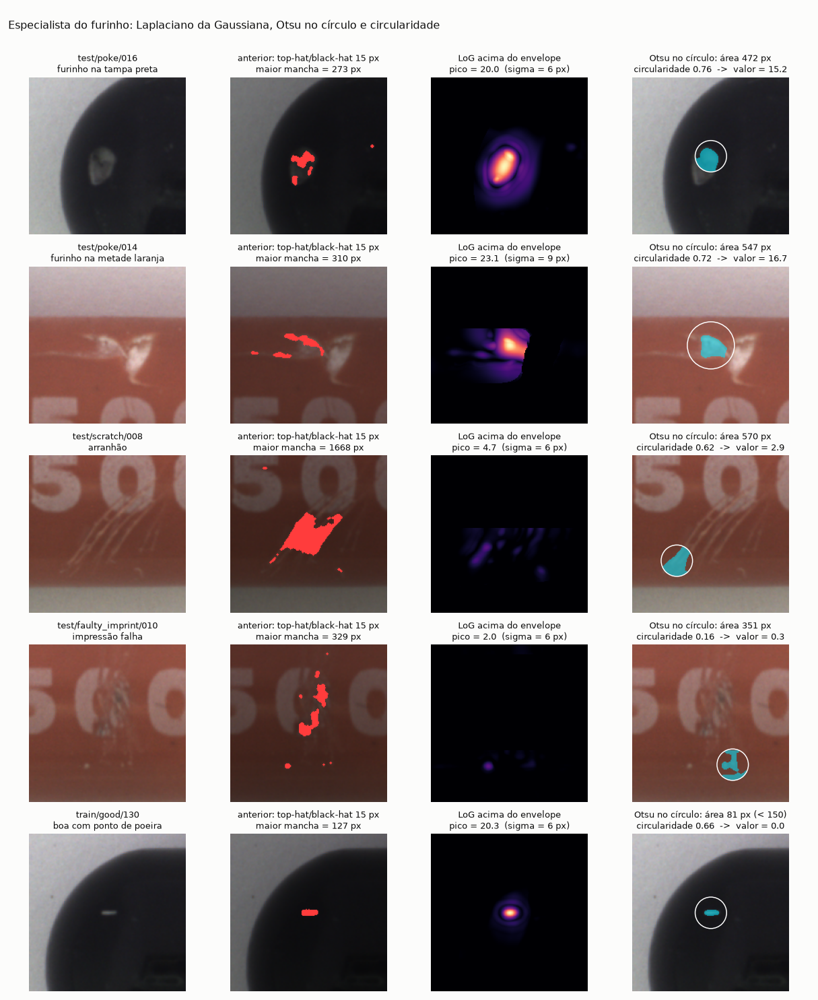
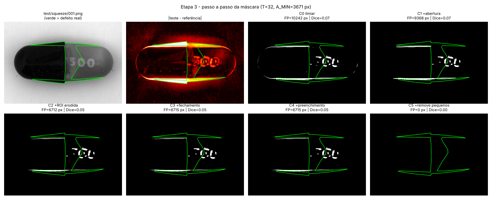
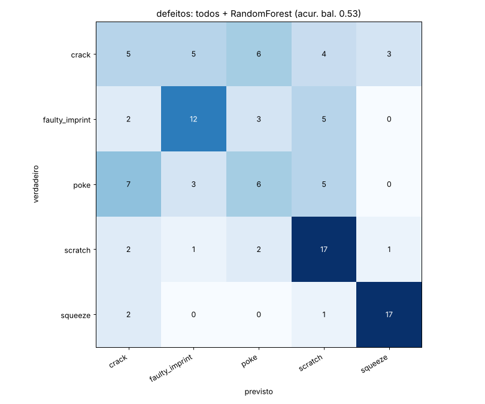
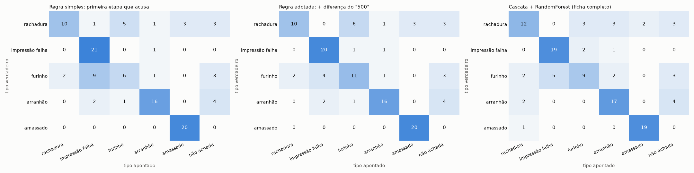
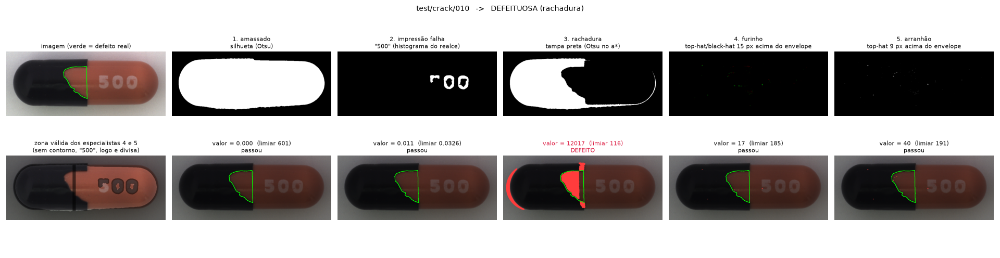
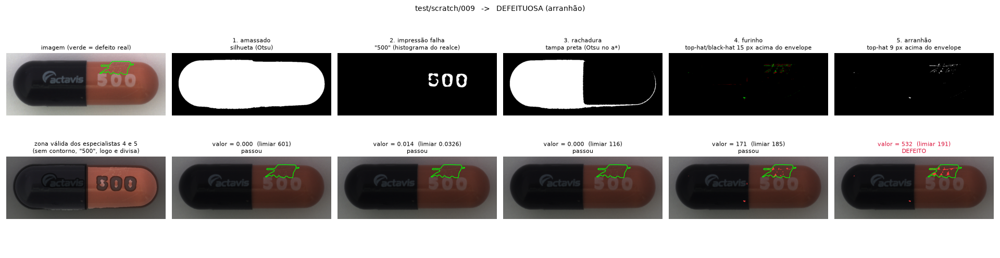
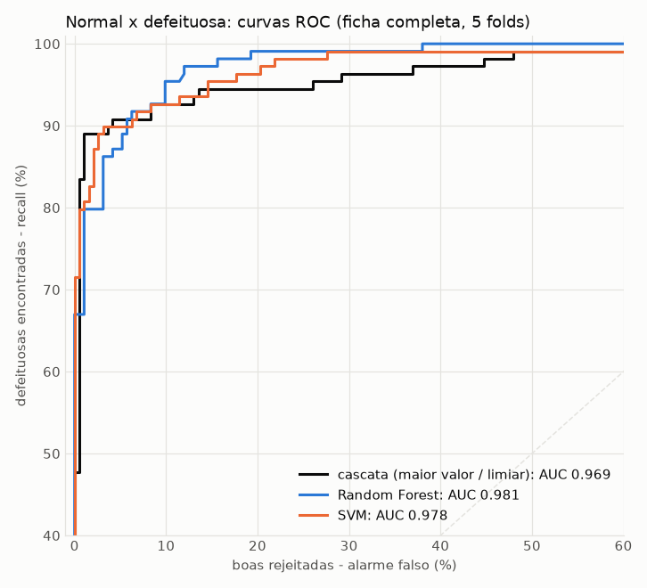
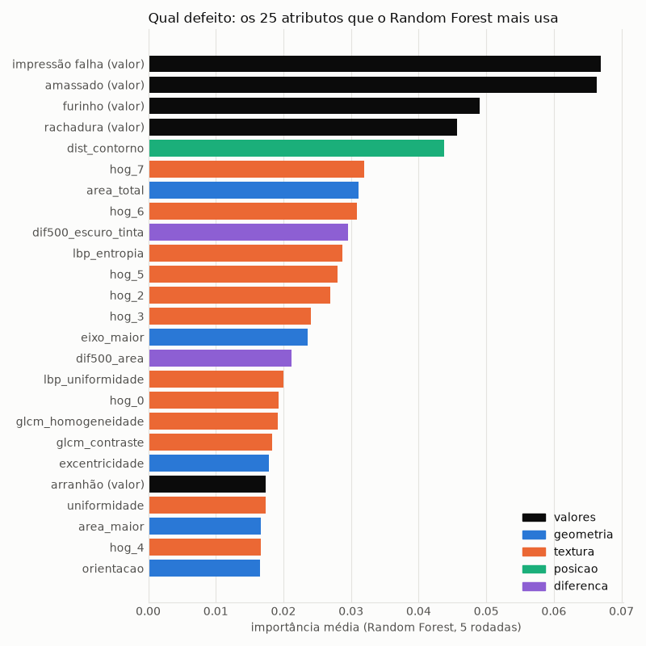
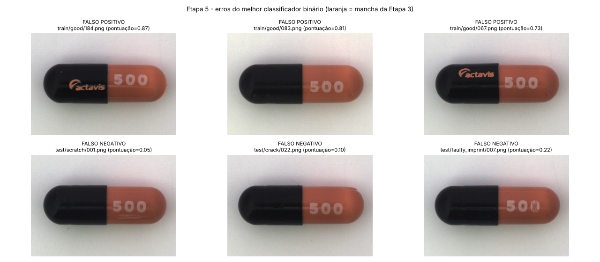

# Detecção e classificação de defeitos em cápsulas com processamento clássico de imagens

**Projeto 4 — Processamento Digital de Imagens (UFSCar) · Prof. Dr. Ricardo J. Ferrari**
Daniel e Murilo · base MVTec AD, categoria *capsule* · código em `src/`, resultados em `resultados/`

> Uso didático: partição própria; os números não são benchmark oficial do MVTec AD.

## Resumo

Investigamos se é possível detectar e classificar defeitos industriais usando apenas
processamento clássico de imagens e atributos interpretáveis. Na categoria *capsule* do MVTec AD,
comparamos duas estratégias de localização: bordas (Canny/Sobel) com morfologia, e diferença em
relação a uma cápsula boa de referência (*golden template*). O *golden template* venceu. Ele foi
aprimorado com a segmentação da impressão "500" e do logo pelo histograma e com o realinhamento
local dessas regiões. Em seguida, medimos o efeito de cada operação morfológica sobre os falsos
positivos, descrevemos a mancha mais suspeita de cada cápsula por 30 atributos (forma, textura,
posição/impressão) e classificamos com SVM e Random Forest em validação cruzada de 5 folds, sem
escolher parâmetros no conjunto de avaliação.

Resultados do método único (Etapas 1–5):
- a localização encontra **64%** das cápsulas defeituosas (Dice médio 0,155);
- a decisão normal × defeituosa atinge acurácia balanceada **0,70** (ROC-AUC 0,75);
- priorizando os defeitos, **94%** das defeituosas são encontradas, mas só 19% das boas são
  aprovadas;
- o tipo de defeito é identificado com acurácia balanceada **0,58** (acaso: 0,20).

Por orientação do professor, trocamos então o método único por **um método especialista para cada
defeito**, em cascata (Etapa 7): a cápsula passa por 5 etapas (amassado, impressão falha,
rachadura, furinho, arranhão) e só é aprovada se nenhuma acusar. Resultados da cascata, com os
limiares de decisão definidos só no treino de cada fold:
- **91%** das defeituosas encontradas com **95%** das boas aprovadas (acurácia balanceada
  **0,93**, ROC-AUC 0,97);
- priorizando os defeitos, **94%** das defeituosas com **87%** das boas aprovadas (antes: 19%);
- todas as cápsulas amassadas e com impressão falha são encontradas; o arranhão, que o método
  único não via (AUC 0,49), passa a ser separado das boas com AUC 0,98;
- a localização acerta **87%** das defeituosas (Dice 0,29).

Na última etapa, também por sugestão do professor, o especialista do furinho foi refeito para
medir a **forma** da mancha: Laplaciano da Gaussiana (LoG) para achar os *blobs*, Otsu num círculo
em volta de cada pico para segmentá-los, e circularidade para separar o furo de riscos e pontos
finos. A versão anterior media só contraste local, acusava também arranhões e impressões falhas e
era redundante (tirá-la da cascata não perdia nenhuma cápsula). Com a nova, a etapa deixa de
acusar arranhões (8 → 1) e impressões (9 → 1), e o tipo apontado sobe de 0,63 para **0,67** (o do
arranhão, de 0,43 para 0,70), com a mesma acurácia balanceada na decisão normal × defeituosa.

Por fim, os experimentos mínimos do enunciado foram refeitos nessa versão final:
- **morfologia:** a abertura reduz os pixels falsos por cápsula boa de 1.985 para 19 no
  especialista do amassado e de 3.261 para 3 no da rachadura;
- **classificadores:** SVM e Random Forest sobre a saída dos especialistas empatam com os
  limiares da cascata na detecção (acurácia balanceada 0,93–0,94; ROC-AUC 0,98 contra 0,97);
- **atributos:** geometria, textura (com cor, GLCM e HOG) e posição da região suspeita não
  melhoram a detecção, mas ajudam a dizer o tipo (Random Forest: 0,65 só com os valores, 0,74
  com a ficha completa);
- **tipo:** o sinal da diferença do "500" para o modelo (falta tinta × material exposto) leva o
  tipo apontado de 0,67 para **0,71** e o acerto do furinho de 0,29 para 0,52.

A resposta à questão de projeto passa a ser **sim para detectar** e **parcialmente para dizer o
tipo**: cada defeito deixa uma marca diferente na imagem, e procurar cada marca com o método certo
funciona muito melhor que um método único. O que ainda limita é separar rachadura e furinho entre
si (tipo apontado com acurácia balanceada 0,71), os defeitos de baixo contraste que nenhum
especialista vê e a variação normal que restou (logo cortado junto à borda, reflexo na ponta da
tampa).

## 1. Problema e questão de projeto

O objetivo é simular a inspeção visual automática de uma linha de produção. A partir da foto de uma
cápsula, o sistema deve **localizar** regiões anômalas, **descrevê-las** por atributos clássicos e
**classificar** a cápsula como normal/defeituosa e pelo tipo de defeito. A questão de projeto do
enunciado é:

> *É possível detectar e classificar defeitos usando apenas processamento clássico e atributos
> interpretáveis?*

Todas as técnicas de imagem usadas foram vistas em aula (filtros, Otsu, morfologia, bordas,
template matching, componentes conexos, descritores de forma, de histograma e LBP). Os
classificadores (SVM e Random Forest) e as métricas são os pedidos no enunciado. O alinhamento
global por ECC, herdado da primeira versão, é a exceção, declarada na seção 8.

## 2. Dados e partição

**Base:** MVTec AD, *capsule*. São imagens RGB de 1000×1000 px de uma cápsula preta/laranja com a
impressão "500" e o logo "actavis", sobre fundo claro.
- `train/good`: 219 normais;
- `test/good`: 23 normais;
- `test/<defeito>`: 109 defeituosas, sendo *crack* 23, *faulty_imprint* 22, *poke* 21, *scratch*
  23 e *squeeze* 20;
- cada defeituosa tem uma máscara de referência (*ground truth*).

**Partição própria** (`src/particao.py` → `dados/particao.csv`, semente 42):

| Conjunto | Imagens | Uso |
|---|---|---|
| `banco` | 30 normais (`train/good` 000–029) | referências do *golden template* |
| `calibracao` | 20 normais (`train/good` 030–049) | calibrar limiares e tamanhos, usando só a variação normal |
| `classificacao` | 192 normais + 109 defeituosas | avaliação da localização; atributos e classificação em validação cruzada de 5 folds estratificados por tipo |

Regra adotada: **quem ajusta não dá nota**. Nenhum limiar ou tamanho é escolhido olhando o conjunto
`classificacao`, e os hiperparâmetros dos classificadores são ajustados só no treino de cada rodada.
Na Etapa 7, o `banco` fornece as referências dos especialistas e os limiares de decisão seguem a
mesma regra (treino de cada rodada); o desenho dos especialistas é a exceção, declarada na seção 8.

## 3. Pipeline

Método único (Etapas 1–5):
```
imagem → cinza + bilateral → cápsula (Otsu) → golden template + realinhamento do "500"/logo
       → limiar calibrado → morfologia → manchas → ficha de 30 atributos → SVM / Random Forest
```
Cascata de especialistas (Etapa 7, seção 3.8):
```
imagem → 1. amassado → 2. impressão falha → 3. rachadura → 4. furinho → 5. arranhão → BOA
         (qualquer etapa que acuse encerra: DEFEITUOSA)
```

### 3.1 Pré-processamento e região de interesse
- Conversão para tons de cinza e **filtro bilateral** (d = 9, σ_cor = 40, σ_espaço = 9). Ele remove
  o ruído preservando o degrau dos defeitos finos; o Gaussiano espalharia o degrau, e a mediana
  apaga estruturas finas.
- **ROI da cápsula:** Otsu invertido (a cápsula é mais escura que o fundo), fechamento 15×15, maior
  componente conexo e erosão de 9 px para excluir o contorno, que acende por desalinhamento.

### 3.2 Localização: duas estratégias (Etapa 1)
- **A — bordas + morfologia:** Canny (15/40, histerese) e Sobel (|G| > 60), seguidos de abertura
  de 3 a 9 px.
- **B — golden template:** entre as 30 cápsulas do banco, escolhe-se a mais parecida com a testada
  (após o alinhamento global); a diferença |teste − referência| marca o que é anômalo.

### 3.3 Impressão e logo pelo histograma
Dentro da máscara da cápsula, o histograma tem modos separados: metade preta (< 45), logo (45–75),
metade laranja (75–112) e impressão (> 112). Como a iluminação deixa a metade laranja com dois tons,
o limiar é calculado no histograma do **realce local** (cinza − mediana 45×45), por Otsu: na metade
clara para o "500", na metade escura para o logo (com um contraste mínimo, porque o logo pode não
estar visível). Seguem abertura e componentes conexos com formato de algarismo ou letra
(`resultados/etapa4/impressao_500.png`).


### 3.4 Golden template com realinhamento local (Etapa 3)
A cápsula gira em torno do próprio eixo. Por isso, mesmo depois do alinhamento global, o "500" e o
logo aparecem alguns pixels deslocados em relação à referência. Na região dessas máscaras (no teste
e na referência), o deslocamento local é estimado por **template matching** (busca de ±20 px) e a
diferença é recalculada com a referência deslocada. A variação de posição desaparece, e uma falha
de impressão continua visível, porque altera a forma.

O **limiar** é o percentil 99 da diferença entre cápsulas boas (`calibracao` × `banco`): T = 27.

### 3.5 Morfologia (Etapa 3)
As operações são aplicadas de forma cumulativa, para medir o efeito de cada uma:
- C0: limiar;
- C1: abertura 5×5;
- C2: ROI erodida 9 px;
- C3: fechamento 5×5;
- C4: preenchimento de buracos;
- C5: remoção de componentes menores que A_MIN, com A_MIN = p95 da maior mancha nas boas de
  calibração (2.450 px).

A máscara **C4** segue para a etapa de atributos (justificativa na seção 5.2).

### 3.6 Atributos (Etapa 4)
Cada mancha com metade ou mais da área sobre o "500" ou o logo é tratada como variação normal. A
**mancha principal** é a maior entre as demais, ou seja, a mais suspeita. A ficha tem 30 atributos
em três grupos:

| Grupo | Atributos |
|---|---|
| Forma | nº de manchas, nº e área das suspeitas, área, perímetro, compacidade (P²/4πA), excentricidade, extensão, solidez, momentos de Hu 1–3 |
| Textura | média e desvio do cinza, média e máximo da diferença ao modelo, suavidade, assimetria, uniformidade e entropia do histograma, entropia e uniformidade do LBP |
| Posição e impressão | fração na metade preta, distância ao contorno, área de mancha sobre o "500" e sobre o logo, área relativa do "500", nº de componentes e de buracos do "500", variação de área entre algarismos |

### 3.7 Classificação (Etapa 5)
- **Tarefas:**
  - normal × defeituosa, nas 301 imagens;
  - qual defeito, nas 109 defeituosas.
- **Classificadores:** SVM (núcleo RBF, atributos padronizados) e Random Forest (300 árvores), com
  `class_weight='balanced'`. Hiperparâmetros por busca em grade com validação interna de 3 partes,
  dentro do treino de cada fold.
- **Ponto de operação "prioriza defeitos":** o limiar sobre a pontuação "defeituosa" é escolhido no
  treino de cada fold como o maior que ainda encontra ≥ 90% das defeituosas do treino.

### 3.8 Cascata de especialistas, um método por defeito (Etapa 7)

**Motivação.** O método único mede "diferença em relação a uma cápsula boa" e trata todo defeito
como uma mancha. Mas cada defeito deixa uma marca própria, e algumas delas quase não geram mancha
(arranhão) ou se confundem com a variação normal (impressão). A orientação do professor foi usar
um método para cada defeito, como já tinha sido feito com o "500", e aprovar a cápsula só se ela
passar por todos (`src/especialistas.py`, `src/cascata.py`).

Cada especialista devolve um número (quanto maior, mais suspeita) e a máscara do que acusou:

| # | Defeito | Marca na imagem | Método | Valor |
|---|---|---|---|---|
| 1 | amassado (*squeeze*) | a silhueta muda | máscara da cápsula (Otsu) × silhueta boa mais parecida: XOR + abertura 7×7 | área da maior região que sobra |
| 2 | impressão falha | o "500" muda | cada algarismo casado com o de cápsulas boas por correlação normalizada (*template matching*) | 1 − correlação do pior algarismo |
| 3 | rachadura (*crack*) | a tampa preta lasca e mostra o laranja, ou sai pó branco | segmentação preto × laranja pela cor (Otsu no a\* do Lab); tampa × tampa boa mais parecida, fora do "500": XOR + abertura 9×9 | área da maior região que sobra |
| 4 | furinho (*poke*) | mancha compacta e arredondada | Laplaciano da Gaussiana (LoG) em 3 escalas acima do envelope; Otsu num círculo em volta de cada pico; circularidade 4πA/P² da região | resposta do LoG × circularidade (região ≥ 150 px) |
| 5 | arranhão (*scratch*) | feixe de riscos finos e claros (3–10 níveis) | *top-hat* de 9 px acima do envelope, limiar 3, sem o bilateral | pixels de fragmentos na janela 101×101 mais cheia |

- **Envelope das cápsulas boas** (especialistas 4 e 5). A cápsula boa também tem estruturas finas
  (linha de reflexo no meio, marca do molde, linhas internas), sempre no mesmo lugar. O envelope é
  o máximo do *top-hat* (e do LoG, no especialista 4) nas 30 boas do banco, dilatado 9 px para
  tolerar a posição; só o que passa dele conta.
- **Zona válida.** O que muda de lugar fica fora da busca dos especialistas 4 e 5: faixa de 13 px
  do contorno, o "500" dilatado (assunto do especialista 2), a divisa preto/laranja e o logo. O
  logo é segmentado como uma cadeia horizontal comprida de componentes claros (fechamento 45×15,
  largura ≥ 100 px), o que não apaga um furinho isolado na tampa preta.
- **Alinhamento.** A pose é estável na base (centro ±3 px, ângulo ±0,3°, tampa preta sempre à
  esquerda), então basta uma translação pelo centroide. A cascata não usa ECC.
- **Limiar de cada etapa**, definido só no treino: `a` = percentil (1 − ALFA) do valor nas boas
  (alarme falso aceito pela etapa); o limiar é o ponto médio entre `a` e o menor valor, acima de
  `a`, entre os defeitos-alvo. ALFA é o ponto de operação: 2% (padrão) ou 5% (prioriza defeitos).
- **Protocolo.** Referências: 30 boas do `banco`. Limiares: validação cruzada com os 5 folds
  (treino = 20 boas de `calibracao` + 4 folds; decisão no 5º).
- **Tipo apontado:** a primeira etapa que acusa, na ordem do mais específico (amassado, impressão)
  para o mais geral (furinho, arranhão), com um refinamento: quando a primeira a acusar é a da
  impressão e a diferença do "500" para o modelo é clara, o tipo é furinho (ver abaixo).

**Especialista do furinho: LoG + Otsu no círculo + circularidade.** A primeira versão desta etapa
media contraste local (*top-hat* e *black-hat* de 15 px acima do envelope, área da maior mancha).
Como arranhões, impressões falhas e rachaduras também têm contraste local, ela acusava todos e
não achava nada que as outras etapas não achassem. O que distingue o furinho é a forma: uma
mancha compacta, e não um risco fino. Por sugestão do professor, a etapa passou a medir a forma
em três passos:



1. **Laplaciano da Gaussiana** normalizado em escala (σ²·∇²G), com σ = 6, 9 e 13 px. O LoG
   responde no centro de manchas arredondadas de raio ≈ σ√2 (17 a 37 px de diâmetro; os furos têm
   30–60 px, com detalhes internos de 5–15 px) e pouco a riscos finos: a resposta a um risco de
   largura *w* cai com *w*/σ. Dois cuidados:
   - a Gaussiana é calculada só com os pixels da zona de busca (soma dos vizinhos válidos
     dividida pela soma dos pesos válidos), separadamente de cada lado da divisa. Sem isso, os
     degraus que não são defeito (fundo, tampa preta, "500", logo) vazam para dentro da zona,
     porque a Gaussiana de σ = 13 alcança ≈ 40 px;
   - como no *top-hat*, só conta o que passa do **envelope**: o máximo da resposta nas 30 boas
     do banco, em cada escala, para *blobs* claros e escuros.
2. **Otsu no círculo.** Os 5 maiores picos do mapa (máximo entre escalas e entre claro/escuro)
   são os candidatos. Em volta de cada um, um círculo de raio 3σ; o limiar de Otsu é calculado
   só com os tons de cinza de dentro do círculo, o que separa a mancha da vizinhança dela (na
   cápsula inteira, o Otsu separaria preto × laranja). O LoG diz onde está o *blob* e se ele é
   claro ou escuro; a região é o componente dessa classe que toca o centro, depois de um
   fechamento 5×5 e uma abertura 3×3.
3. **Circularidade** da região, 4πA/P² (1 = círculo; um risco de 4 px que atravessa a janela dá
   ≈ 0,2). O valor da etapa é o maior **resposta do LoG × circularidade** entre os candidatos
   com **área ≥ 150 px**. A área mínima tira os pontos de poeira das cápsulas boas, que são
   *blobs* perfeitos (circularidade ≈ 0,9), mas têm 80–110 px.

A zona de busca desta etapa é a zona válida menos o **retângulo onde o "500" casou** com o modelo
do banco (o casamento do especialista 2). A máscara do "500" sozinha não basta: em parte das boas
ela perde um pedaço do "5", que vira um *blob* claro de ≈ 40 px. Dentro do retângulo da impressão
quem responde é o especialista 2.

Na figura: nos dois furinhos o LoG tem um pico forte e a região é compacta; no arranhão e na
impressão falha, que o método anterior marcava com 1.668 e 329 px, o LoG quase não responde; na
cápsula boa, o ponto de poeira tem pico alto, mas a região tem 81 px e o valor é zero.

**Refinamento do tipo pela diferença do "500".** A etapa 2 mede quanto a impressão mudou, e um
furinho em cima do "500" também a muda: 9 dos 21 furinhos saíam como "impressão falha". O sinal
da diferença para o modelo casado diz o que mudou. Na impressão falha **falta tinta**: nos pixels
com |diferença| > 30, a cápsula está mais escura que o modelo (fração clara = 0 em 16 das 17
impressões falhas com diferença marcada). Um furo sobre a impressão expõe material **mais
claro**, também fora dos traços (fração clara ≥ 0,34 em 6 dos 7 furinhos com diferença
marcada). Quando a etapa 2 é a primeira a acusar e a fração clara passa de um corte, o tipo
apontado é furinho. O corte é aprendido no treino de cada fold (o que melhor separa as
impressões falhas dos furinhos acusados pela etapa 2; ≈ 0,17 em 4 folds e 0,45 em um). Isso
muda só o nome do defeito, não a decisão normal × defeituosa.

**Atributos e classificadores sobre os especialistas** (`src/classificacao_cascata.py`). Para
refazer na versão final as comparações do enunciado, a saída dos especialistas vira uma ficha
de 50 atributos (mais 24 globais), entregue a um SVM (núcleo RBF) e a um Random Forest (300
árvores), com o protocolo da Etapa 5: 5 folds da partição, padronização e hiperparâmetros só no
treino, classes balanceadas por peso; as 20 boas de calibração entram sempre no treino.

| Grupo | Atributos | Calculados sobre |
|---|---|---|
| Valores (5) | os 5 valores dos especialistas | o que a cascata usa |
| Geometria (12) | nº de manchas, área total, largura e altura da caixa; área, perímetro, compacidade, excentricidade, extensão, solidez, eixo maior e orientação da maior mancha | região suspeita |
| Textura (25) | média, desvio e contraste com um anel de 7 px; cor (média e desvio de a\* e b\*); histograma (suavidade, assimetria, uniformidade, entropia); LBP (entropia, uniformidade); GLCM (contraste, homogeneidade, energia, correlação; 16 níveis, 4 direções); HOG (8 orientações do gradiente) | pixels da região suspeita |
| Posição (4) | fração na tampa preta e sobre o "500", distância ao contorno, posição ao longo da cápsula | região suspeita |
| Diferença (4) | área, fração clara, pixels claros fora dos traços e escuros sobre os traços | diferença do "500" para o modelo casado |
| Global (24) | os mesmos descritores de textura | cápsula inteira (extensão opcional) |

A **região suspeita** é a união das máscaras que os 5 especialistas devolvem, sem o limiar de
decisão (não depende de rótulos). Três tarefas: **binária** (normal × defeituosa, 301 imagens),
**tipo** (qual dos 5 defeitos, nas 109 defeituosas) e **sistema** (a cascata decide e o
classificador dá o tipo das acusadas), sempre comparadas com a regra da cascata.

**Correção da coluna da divisa.** Ao implementar o LoG apareceu um erro antigo: em 17 das 351
imagens a divisa preto/laranja era estimada na ponta esquerda da tampa (x ≈ 85 em vez de ≈ 515),
porque o brilho da ponta deixa as primeiras colunas claras, e a faixa da divisa não saía da zona
válida. A regra passou a ser "coluna seguinte à última majoritariamente preta", idêntica à
anterior nas outras 334 imagens. Sozinha, a correção não muda nenhuma decisão da cascata em
ALFA = 2% (o AUC do furinho anterior passa de 0,967 para 0,961).

## 4. Experimentos realizados (enunciado × onde está)

A Etapa 7 é a versão final do projeto. Todos os experimentos mínimos e as métricas do enunciado
foram refeitos nela; as Etapas 1–5 ficam como o caminho que levou até lá.

| Experimento mínimo | Na versão final (Etapa 7) | Nas etapas anteriores |
|---|---|---|
| Comparar duas estratégias de localização | 5.5: método único (golden template) × cascata, pixel a pixel; e 3 a 7 candidatos por defeito, entre eles as segmentações por k-means e por crescimento de região | 5.1 (bordas × golden template) |
| Quantificar o efeito da morfologia sobre falsos positivos | 5.6: cada especialista sem e com as suas operações morfológicas | 5.2 |
| Comparar atributos geométricos, de textura e a combinação completa | 5.7: valores, geometria, textura, posição, diferença e completo | 5.4 |
| Comparar pelo menos dois classificadores | 5.7: SVM × Random Forest × regra da cascata | 5.4 |
| Separar resultados por tipo de defeito | 5.5 a 5.7 (encontradas, localização e acerto do tipo, por tipo) | 5.3 e 5.4 |
| Extensão opcional: atributos da região × globais | 5.7 (textura da região suspeita × da cápsula inteira) | — |

| Métrica ou entregável | Na versão final (Etapa 7) | Arquivo em `resultados/etapa7/` |
|---|---|---|
| Segmentação: Dice, IoU, precisão e recall pixel a pixel | 5.5 (cascata, por tipo) e 5.6 (cada especialista) | `localizacao.txt`, `tabela_morfologia.txt` |
| Classificação: F1, acurácia balanceada, ROC-AUC (normal × defeituosa) | 5.5 (cascata) e 5.7 (classificadores) | `tabela_cascata.txt`, `classificadores_binaria.txt`, `roc_binaria.png` |
| Classificação por tipo: acurácia balanceada, F1 macro, matriz de confusão | 5.5 e 5.7 | `disparos_por_tipo.txt`, `classificadores_tipo.txt`, `sistema_final.txt`, `matriz_confusao_tipo.png` |
| Exemplos de falsos positivos e falsos negativos | 6 | `erros.csv`, `erro_*.png` |
| Discussão das etapas que mais limitam o desempenho | 7 | — |

Do pipeline sugerido no enunciado, o que ainda não tinha sido usado foi testado nesta versão:

| Item do pipeline sugerido | Onde entrou | Resultado |
|---|---|---|
| Segmentação por k-means | candidato da rachadura (tampa preta) | não ganha do Otsu no a\* (AUC 0,754 × 0,773) |
| Segmentação por regiões | candidato do furinho (crescimento a partir do pico do LoG) | acha menos furinhos que o Otsu no círculo (8 × 12) |
| Diferença em relação a uma referência, como atributo | sinal da diferença do "500" para o modelo casado | **adotado**: tipo apontado 0,67 → 0,71; furinho 0,29 → 0,52 |
| Cor (médias e desvios) | a\* e b\* da região suspeita | sem efeito isolado mensurável |
| Orientação | ângulo do eixo maior da maior mancha | sem efeito isolado mensurável |
| GLCM | contraste, homogeneidade, energia e correlação da região | sem efeito isolado mensurável |
| HOG | histograma de 8 orientações do gradiente na região | sem efeito isolado mensurável; os quatro juntos: tipo 0,68 → 0,74 (Random Forest) |
| Classificação com SVM/RF | sobre a saída dos especialistas | empata com a cascata (detecção 0,93–0,94; tipo 0,70 × 0,71) |

Já estavam aplicados: denoising (bilateral; Gaussiano no arranhão, porque o bilateral apaga os
riscos), bordas (Canny/Sobel na Etapa 1 e como candidato do arranhão), morfologia, limiarização
(Otsu), diferença em relação a uma referência, geometria, intensidade, histograma e LBP.

## 5. Resultados

### 5.1 Bordas × golden template (Etapa 1, nas 132 imagens de `test/`)

Métricas:
- **hit:** fração de defeituosas com ≥ 30 px marcados dentro do *ground truth*;
- **FP/boa:** pixels marcados por cápsula boa;
- **precisão:** pixel a pixel.

| Estratégia | hit | FP/boa | Precisão |
|---|---:|---:|---:|
| Canny 15/40, sem abertura | 0,72 | 2.476 | 0,09 |
| Canny 15/40, abertura 3 | 0,42 | 247 | 0,24 |
| Canny 15/40, abertura 9 | 0,02 | 0 | 0,70 |
| **Golden template, limiar 30, abertura 5** | **0,63** | 2.792 | **0,31** |

As bordas não separam defeito de estrutura normal: a cápsula boa já é cheia de bordas (impressão,
logo, divisão das metades, contorno). A abertura que apaga essas bordas apaga os defeitos na mesma
proporção, porque rachaduras e arranhões também são finos. O golden template marca a **região** do
defeito, com precisão três vezes maior, e foi a estratégia adotada. (Nesta etapa, parâmetros e
avaliação usaram o mesmo `test/`; isso foi corrigido a partir da partição própria.)

### 5.2 Efeito da morfologia e do realinhamento (Etapa 3, 301 imagens de `classificacao`)

| Etapa (cumulativa) | hit | FP px/boa | Boas com alarme | Precisão | Dice | IoU |
|---|---:|---:|---:|---:|---:|---:|
| C0 limiar | 0,68 | 2.416 | 99% | 0,31 | 0,155 | 0,101 |
| C1 + abertura 5 | 0,65 | 1.905 | 86% | 0,34 | 0,159 | 0,106 |
| C2 + ROI erodida | 0,64 | 1.832 | 86% | 0,34 | 0,155 | 0,103 |
| C3 + fechamento | 0,64 | 1.856 | 86% | 0,34 | 0,156 | 0,104 |
| **C4 + preenchimento** | **0,64** | **1.913** | **86%** | **0,34** | **0,155** | **0,104** |
| C5 + remove < 2.450 px | 0,17 | 568 | 10% | 0,45 | 0,058 | 0,042 |


- A **abertura** é a operação que mais reduz falsos positivos (boas com alarme: 99% → 86%). ROI
  erodida, fechamento e preenchimento quase não mudam os números, mas deixam as manchas sólidas
  para a descrição.
- A **remoção por área** elimina quase todos os alarmes e quase todos os defeitos: as manchas falsas
  das boas têm o tamanho dos defeitos. Por isso seguimos com **C4**.
- O **realinhamento local do "500" e do logo** reduziu a variação normal (o limiar calibrado caiu de
  32 para 27) e melhorou a localização:

| Máscara C4 | hit | FP px/boa | Dice | hit *crack* | hit *faulty_imprint* |
|---|---:|---:|---:|---:|---:|
| sem realinhamento | 0,57 | 2.398 | 0,126 | 0,65 | 0,59 |
| com realinhamento | **0,64** | **1.913** | **0,155** | **0,83** | **0,82** |

### 5.3 Localização por tipo de defeito (máscara final C4)

| Tipo | hit | Precisão | Recall | Dice | IoU |
|---|---:|---:|---:|---:|---:|
| *crack* | 0,83 | 0,51 | 0,22 | 0,246 | 0,176 |
| *faulty_imprint* | 0,82 | 0,14 | 0,08 | 0,082 | 0,044 |
| *poke* | 0,67 | 0,44 | 0,18 | 0,229 | 0,161 |
| *scratch* | 0,00 | 0,00 | 0,00 | 0,000 | 0,000 |
| *squeeze* | 0,95 | 0,40 | 0,25 | 0,233 | 0,145 |

As manchas são parciais (recall pixel a pixel ≤ 0,25): o método marca pedaços do defeito (bordas
do *poke*, extremidades do *squeeze*), o que basta para "achar" a cápsula, mas não para delinear o
defeito. O *scratch* é fino e de baixo contraste demais para a diferença ao modelo.



### 5.4 Classificação (Etapa 5)

**Normal × defeituosa** (301 imagens; acaso: acurácia balanceada 0,50):

| Grupo | SVM: acur. bal. / F1 / AUC | Random Forest: acur. bal. / F1 / AUC |
|---|---|---|
| forma | 0,59 / 0,33 / 0,64 | 0,64 / 0,53 / 0,65 |
| textura | 0,58 / 0,45 / 0,65 | 0,59 / 0,45 / 0,63 |
| posição/impressão | 0,66 / 0,55 / 0,69 | 0,70 / 0,60 / 0,74 |
| **todos** | **0,70 / 0,60 / 0,75** | 0,70 / 0,60 / 0,75 |

Com a decisão padrão (todos + RF): precisão 0,70, recall 0,52, especificidade 0,87.

**Priorizando os defeitos** (limiar escolhido no treino para recall ≥ 90%):

| Grupo | SVM: recall / especificidade | Random Forest: recall / especificidade |
|---|---|---|
| forma | 0,91 / 0,13 | 0,94 / 0,06 |
| textura | 0,92 / 0,21 | 0,95 / 0,12 |
| posição/impressão | 0,92 / 0,18 | 0,94 / 0,18 |
| **todos** | **0,94 / 0,19** | 0,94 / 0,19 |

Todos + SVM encontra 102 das 109 defeituosas (*crack* 21/23, *faulty_imprint* 22/22, *poke* 19/21,
*scratch* 21/23, *squeeze* 19/20), aprovando 37 das 192 boas.


**Qual defeito** (109 defeituosas; acaso: 0,20):

| Grupo | SVM: acur. bal. / F1 macro | Random Forest: acur. bal. / F1 macro |
|---|---|---|
| forma | 0,39 / 0,39 | 0,38 / 0,38 |
| textura | 0,53 / 0,53 | 0,45 / 0,43 |
| posição/impressão | 0,33 / 0,34 | 0,50 / 0,49 |
| **todos** | 0,55 / 0,54 | **0,58 / 0,57** |

Acerto por tipo (todos + RF): *squeeze* 0,90, *faulty_imprint* 0,86, *crack* 0,43, *scratch*
0,43, *poke* 0,29.



- **A combinação completa** é a melhor nas duas tarefas. Nenhum grupo sozinho chega lá.
- Na decisão normal × defeituosa, o grupo **posição/impressão** sozinho chega perto do total; para
  o tipo, **textura** e **forma** pesam mais. Os atributos mais usados pelo Random Forest são área e
  perímetro da mancha suspeita, área relativa do "500", diferença média ao modelo e variação de área
  entre algarismos (`importancia_atributos.png`).
- **SVM × Random Forest:** desempenho equivalente na decisão normal × defeituosa; o Random Forest é
  melhor para o tipo de defeito.

### 5.5 Cascata de especialistas (Etapa 7)

**Qual método para cada defeito** (`src/comparar_candidatos.py` →
`resultados/etapa7/tabela_candidatos.txt`). AUC do defeito-alvo contra as boas; "achadas" é a
fração do defeito-alvo acima do percentil 98 das boas de treino (5 folds):

| Defeito | Método | AUC | Achadas |
|---|---|---:|---:|
| amassado | método único (maior mancha do golden template) | 0,992 | 0,95 |
| | descritores globais da silhueta | 0,993 | 0,95 |
| | **XOR com a silhueta boa mais parecida + abertura** | **1,000** | **1,00** |
| impressão falha | método único | 0,666 | 0,05 |
| | desvio da área do "500" (Etapa 4) | 0,817 | 0,36 |
| | correlação do "500" inteiro | 0,999 | 0,95 |
| | **correlação do pior algarismo** | **1,000** | **1,00** |
| rachadura | método único | 0,726 | 0,26 |
| | forma da tampa preta, Otsu no cinza | 0,636 | 0,13 |
| | forma da tampa preta, k-means (2 grupos) em a\*, b\* | 0,754 | 0,52 |
| | **forma da tampa preta, Otsu no a\*** | **0,773** | **0,52** |
| | contraste local 15 px (método anterior do furinho) | 0,935 | 0,57 |
| | *blobs* do LoG + circularidade (especialista do furinho) | 0,844 | 0,65 |
| furinho | método único | 0,562 | 0,05 |
| | top-hat/black-hat 15 px, sem envelope | 0,752 | 0,00 |
| | top-hat/black-hat 25 px, acima do envelope | 0,904 | 0,52 |
| | top-hat/black-hat 15 px, acima do envelope (anterior) | 0,961 | 0,62 |
| | anterior, só manchas com circularidade ≥ 0,4 | 0,922 | 0,33 |
| | LoG em 3 escalas, acima do envelope (maior pico) | 0,880 | 0,48 |
| | LoG + crescimento de região + circularidade | 0,845 | 0,38 |
| | **LoG + Otsu no círculo + circularidade** | **0,817** | **0,57** |
| arranhão | método único | 0,492 | 0,00 |
| | pixels de borda do Canny (Etapa 1) | 0,539 | 0,04 |
| | maior risco (top-hat 9 px), acima do envelope | 0,961 | 0,61 |
| | concentração de fragmentos, sem envelope | 0,934 | 0,30 |
| | **concentração de fragmentos, acima do envelope** | **0,983** | **0,87** |

- O envelope é decisivo: o mesmo top-hat sem ele acha 0% dos furinhos e 30% dos arranhões.
- No arranhão, o risco sai picotado pelo limiar baixo; a concentração de fragmentos diz mais que
  o maior pedaço.
- Na rachadura, o contraste local e os *blobs* do LoG têm AUC maior, mas os *blobs* já são a
  etapa 4. A forma da tampa foi mantida como etapa 3 porque é ela que dá nome à rachadura (acusa
  12 das 23 antes que cheguem ao furinho).
- No furinho, o AUC contra as boas **não** foi o critério de escolha: o método anterior ganha
  nele (0,961) justamente porque reage a qualquer contraste local. O critério foi acusar o
  furinho sem acusar os outros defeitos (tabela abaixo).

**Furinho: quem cada candidato acusa** (cápsulas acima do percentil 98 das boas de treino,
5 folds; o ideal é acusar só o furinho):

| Candidato | boas (192) | rachadura (23) | impressão (22) | **furinho (21)** | arranhão (23) | amassado (20) |
|---|---:|---:|---:|---:|---:|---:|
| top-hat/black-hat 15 px, acima do envelope (anterior) | 4 | 13 | 10 | **13** | 12 | 6 |
| anterior, só manchas com circularidade ≥ 0,4 | 2 | 10 | 3 | **7** | 3 | 3 |
| LoG em 3 escalas (maior pico) | 5 | 15 | 3 | **10** | 2 | 4 |
| LoG + crescimento de região + circularidade | 5 | 10 | 0 | **8** | 0 | 6 |
| **LoG + Otsu no círculo + circularidade** | 5 | 15 | 1 | **12** | 1 | 7 |

- O **LoG** é o que tira os arranhões (12 → 2) e as impressões falhas (10 → 3): riscos finos não
  formam *blob* nas escalas do furo.
- **Otsu no círculo, circularidade e área mínima** recuperam furinhos (10 → 12) e tiram mais
  impressões (3 → 1). Nos limiares mais frouxos a circularidade pesa mais: em ALFA = 5%, a etapa
  com LoG e área mínima, mas sem a circularidade, acusa 5 arranhões; com ela, 1.
- Medir a circularidade direto na máscara do *top-hat*, sem o LoG, não funciona: a máscara sai
  picotada e os próprios furos ficam com circularidade baixa (13 → 7 furinhos achados).
- Rachaduras e amassados continuam acusados (lascas e dobras também são manchas compactas), mas
  passam antes pelas etapas 1 e 3.
- O AUC menor contra as boas (0,817) vem dos furinhos sobre o "500", que ficam fora da zona de
  busca desta etapa.
- **Segmentações do pipeline sugerido que faltavam:** o k-means na tampa (2 grupos no plano
  a\*, b\*) dá quase a mesma máscara do Otsu no a\* e não ganha dele (AUC 0,754 contra 0,773);
  o crescimento de região a partir do pico do LoG (tolerância de 10 níveis) acha menos furinhos
  que o Otsu no círculo (8 contra 12), porque o interior do furo não é homogêneo.

**Normal × defeituosa** (`tabela_cascata.txt`; 301 imagens, 5 folds):

| ALFA | Boas aprovadas | Defeituosas encontradas | Acur. bal. | Precisão | crack / imprint / poke / scratch / squeeze |
|---|---:|---:|---:|---:|---|
| 1% | 0,98 | 0,89 | 0,93 | 0,96 | 0,87 / 0,95 / 0,86 / 0,78 / 1,00 |
| **2% (padrão)** | **0,95** (183/192) | **0,91** (99/109) | **0,93** | **0,92** | 0,87 / 1,00 / 0,86 / 0,83 / 1,00 |
| 3% | 0,91 | 0,94 | 0,92 | 0,86 | 0,87 / 1,00 / 0,95 / 0,87 / 1,00 |
| **5% (prioriza defeitos)** | **0,87** (167/192) | **0,94** (103/109) | **0,91** | 0,80 | 0,91 / 1,00 / 0,95 / 0,87 / 1,00 |
| 8% | 0,83 | 0,95 | 0,89 | 0,76 | 0,91 / 1,00 / 0,95 / 0,91 / 1,00 |

ROC-AUC da cascata: 0,97 (método único: 0,75).


**Que etapa acusa cada tipo** (ALFA = 2%):


- Amassado e impressão são específicos: quase só acusam o próprio defeito (a impressão também
  acusa furinhos e arranhões que caem sobre o "500").
- O furinho acusa manchas compactas: furinhos, lascas de rachadura e dobras de amassado, e quase
  nenhum arranhão ou impressão falha. O arranhão mede contraste local fino e reage a quase todos
  os defeitos.
- **Tipo apontado** (primeira etapa que acusa, refinada pela diferença do "500"): acurácia
  balanceada **0,71** nas 5 classes, contando defeituosa não achada como erro, e F1 macro 0,70.
  Por tipo: amassado 1,00, impressão falha 0,91, arranhão 0,70, furinho 0,52, rachadura 0,43.
  Entre as defeituosas achadas, o tipo está certo em 78%.
- **Efeito do refinamento:** só com a primeira etapa, o tipo apontado é 0,67 (furinho 0,29,
  impressão falha 0,95). Olhar o sinal da diferença tira 5 furinhos da coluna "impressão falha"
  (9 → 4) e põe 1 impressão falha em "furinho" (`faulty_imprint/013`, em que a diferença é
  clara).



**Furinho antes × depois** (`furinho_antes_depois.txt`): a mesma cascata, trocando só o valor da
etapa 4 (anterior = *top-hat*/*black-hat* de 15 px, área da maior mancha). Nesta comparação o
tipo é o da regra simples (primeira etapa que acusa), sem o refinamento, para isolar o efeito da
etapa 4.

| Etapa do furinho | ALFA | Boas aprovadas | Defeituosas encontradas | Acur. bal. | Tipo apontado | Acerto do tipo: rachadura / impressão / furinho / arranhão / amassado |
|---|---|---:|---:|---:|---:|---|
| anterior | 2% | 0,96 | 0,90 | 0,93 | 0,63 | 0,43 / 0,95 / 0,33 / 0,43 / 1,00 |
| **LoG + Otsu + circularidade** | 2% | 0,95 | 0,91 | 0,93 | **0,67** | 0,43 / 0,95 / 0,29 / **0,70** / 1,00 |
| anterior | 5% | 0,90 | 0,94 | 0,92 | 0,59 | 0,43 / 0,95 / 0,33 / 0,22 / 1,00 |
| **LoG + Otsu + circularidade** | 5% | 0,87 | 0,94 | 0,91 | **0,68** | 0,43 / 0,95 / 0,33 / **0,70** / 1,00 |

O que a etapa do furinho acusa em ALFA = 2%:

| | boa (192) | rachadura (23) | impressão (22) | furinho (21) | arranhão (23) | amassado (20) | só ela acusa |
|---|---:|---:|---:|---:|---:|---:|---|
| anterior | 3 | 12 | 9 | 12 | 8 | 4 | 1 boa, nenhuma defeituosa |
| **depois** | 3 | 15 | **1** | 11 | **1** | 7 | 3 boas, 1 rachadura |

AUC do valor da etapa para separar cada tipo das boas (0,50 = a etapa não reage ao tipo):
arranhão 0,914 → 0,730; impressão falha 0,939 → 0,603; furinho 0,961 → 0,817; rachadura
0,935 → 0,844; amassado 0,873 → 0,943.

- **A etapa deixou de acusar o que não é mancha compacta:** arranhões 8 → 1, impressões 9 → 1.
  Sete arranhões eram chamados de furinho; agora, um. O acerto do tipo "arranhão" sobe de 0,43
  para 0,70 e o tipo apontado nas 5 classes, de 0,63 para 0,67 (em ALFA = 5%, de 0,59 para 0,68).
- **Ela deixou de ser redundante:** antes, tirá-la não perdia nenhuma defeituosa; agora perde uma
  rachadura que nenhuma outra etapa acha.
- **Custo:** os alarmes falsos dela não coincidem mais com os do arranhão (antes, as duas etapas
  mediam contraste local e erravam nas mesmas boas). A cascata rejeita 2 boas a mais em
  ALFA = 2% (185 → 183) e, em ALFA = 5%, as boas aprovadas caem de 0,90 para 0,87 com o mesmo
  recall. A acurácia balanceada fica igual em 2% (0,93) e cai de 0,92 para 0,91 em 5%.
- **O que não mudou:** o acerto do próprio furinho (7 → 6 de 21). Nove furinhos ficam sobre o
  "500" ou encostados nele e são acusados antes pela etapa da impressão, 2 pela da rachadura,
  1 só pela do arranhão e 3 não são achados por nenhuma etapa.
- Com ~20 cápsulas por defeito, diferenças de uma ou duas cápsulas estão dentro da variação
  esperada; o efeito consistente é a queda dos arranhões e das impressões acusados pela etapa.

**Ablação** (`ablacao.txt`, ALFA = 2%):

| Configuração | Boas aprovadas | Defeituosas encontradas | O que se perde |
|---|---:|---:|---|
| cascata completa | 0,95 | 0,91 | — |
| sem amassado | 0,95 | 0,89 | 1 amassado e 1 rachadura |
| sem impressão falha | 0,96 | 0,80 | 6 impressões falhas, 5 furinhos e 1 rachadura |
| sem rachadura | 0,95 | 0,90 | 1 rachadura |
| sem furinho | 0,97 | 0,90 | 1 rachadura (e 3 boas voltam a ser aprovadas) |
| sem arranhão | 0,98 | 0,73 | 16 arranhões, 1 impressão falha, 1 furinho e 1 rachadura |

Com o furinho medindo forma, o arranhão ficou mais necessário (antes, parte dos arranhões também
era acusada pelo furinho) e a rachadura, menos: as lascas que ela acha agora também são achadas
como *blob* pelo furinho, mas é a etapa 3 que lhes dá o nome certo.

**Localização** (`localizacao.txt`; união das máscaras das etapas que acusaram × ground truth):

| | hit | Precisão | Dice | FP px/boa | Boas com pixel marcado |
|---|---:|---:|---:|---:|---:|
| método único (C4, Etapa 3) | 0,64 | 0,34 | 0,155 | 1.913 | 86% |
| **cascata (ALFA = 2%)** | **0,87** | **0,53** | **0,292** | **19** | **5%** |

Por tipo (hit / Dice): rachadura 0,87 / 0,385; impressão falha 0,95 / 0,313; furinho
0,71 / 0,300; arranhão 0,83 / 0,195; amassado 1,00 / 0,268.





### 5.6 Efeito da morfologia em cada especialista (Etapa 7)

`src/comparar_candidatos.py` → `resultados/etapa7/tabela_morfologia.txt`. Cada especialista é
rodado sem e com as suas operações morfológicas. A máscara é a que ele devolve, **sem o limiar
de decisão**: nas 192 boas, todo pixel marcado é falso; no defeito-alvo, ela é comparada pixel a
pixel com o ground truth (hit = ≥ 30 px dentro do defeito). AUC e achadas medem o valor do
especialista, como na tabela de candidatos.

| Especialista | Operação | FP px/boa | Boas com pixel marcado | hit no alvo | Precisão | Dice | AUC | Achadas |
|---|---|---:|---:|---:|---:|---:|---:|---:|
| amassado | XOR das silhuetas | 1.985 | 100% | 1,00 | 0,36 | 0,199 | 1,000 | 1,00 |
| | **+ abertura 7×7** | **19** | **27%** | 1,00 | 0,43 | 0,213 | 1,000 | 1,00 |
| impressão falha | \|teste − modelo\| > 30 | 1 | 8% | 0,73 | 0,97 | 0,093 | 1,000 | 1,00 |
| | + abertura 3×3 | 1 | 5% | 0,73 | 0,97 | 0,091 | 1,000 | 1,00 |
| rachadura | XOR das tampas | 3.261 | 100% | 0,78 | 0,23 | 0,137 | 0,729 | 0,17 |
| | **+ abertura 9×9** | **3** | **4%** | 0,57 | 0,65 | 0,181 | 0,773 | 0,52 |
| furinho | Otsu no círculo | 641 | 100% | 0,62 | 0,53 | 0,204 | 0,831 | 0,57 |
| | + fechamento 5 e abertura 3 | 617 | 100% | 0,62 | 0,54 | 0,205 | 0,817 | 0,57 |
| arranhão | fragmentos do *top-hat* | 60 | 95% | 1,00 | 0,80 | 0,122 | 0,985 | 0,87 |
| | + remoção < 4 px e fechamento 15 | 62 | 89% | 1,00 | 0,87 | 0,205 | 0,983 | 0,87 |

- A **abertura** é decisiva nos dois especialistas que comparam formas por XOR: entre duas
  cápsulas boas sobra uma casca fina ao longo do contorno, e a abertura a remove. Os pixels falsos
  por cápsula boa caem de 1.985 para 19 (amassado) e de 3.261 para 3 (rachadura), e as boas com
  algum pixel marcado, de 100% para 27% e 4%. Na rachadura isso é o que torna o valor útil
  (achadas 0,17 → 0,52), ao custo de perder as lascas mais finas (hit 0,78 → 0,57).
- No **arranhão**, remover os fragmentos menores que 4 px quase não muda os falsos positivos; o
  fechamento junta o feixe de riscos numa região e melhora a máscara (Dice 0,12 → 0,21).
- No **furinho** e na **impressão**, a morfologia não tem efeito mensurável: a região do furinho
  já sai limpa do Otsu no círculo, e a máscara da impressão quase não tem pixels soltos.
- A máscara do furinho marca 100% das boas porque é a região do melhor *blob*, exista defeito ou
  não; quem decide é o limiar da etapa. Com a decisão da cascata, sobram 19 px falsos por
  cápsula boa e 5% das boas com algum pixel marcado (`localizacao.txt`).

### 5.7 Atributos e classificadores sobre os especialistas (Etapa 7)

`src/classificacao_cascata.py`; fichas em `dados/atributos_cascata.csv`. Os números entre
parênteses são a quantidade de atributos de cada grupo.

**Normal × defeituosa** (`classificadores_binaria.txt`; 301 imagens, 5 folds, decisão padrão):

| Atributos | Decisão | Acur. bal. | Precisão | Recall | Especificidade | F1 | ROC-AUC |
|---|---|---:|---:|---:|---:|---:|---:|
| valores (5) | **cascata (um limiar por etapa)** | 0,931 | 0,917 | 0,908 | 0,953 | 0,912 | 0,969 |
| valores (5) | SVM | 0,925 | 0,941 | 0,881 | 0,969 | 0,910 | 0,979 |
| valores (5) | Random Forest | **0,940** | 0,918 | 0,927 | 0,953 | **0,922** | **0,982** |
| geometria (12) | SVM | 0,868 | 0,827 | 0,835 | 0,901 | 0,831 | 0,935 |
| geometria (12) | Random Forest | 0,875 | 0,823 | 0,853 | 0,896 | 0,838 | 0,949 |
| textura (25) | SVM | 0,881 | 0,867 | 0,835 | 0,927 | 0,850 | 0,952 |
| textura (25) | Random Forest | 0,871 | 0,835 | 0,835 | 0,906 | 0,835 | 0,938 |
| posição (4) | SVM | 0,727 | 0,660 | 0,642 | 0,812 | 0,651 | 0,782 |
| posição (4) | Random Forest | 0,735 | 0,670 | 0,651 | 0,818 | 0,660 | 0,808 |
| diferença (4) | SVM | 0,629 | 0,861 | 0,284 | 0,974 | 0,428 | 0,620 |
| diferença (4) | Random Forest | 0,632 | 0,886 | 0,284 | 0,979 | 0,431 | 0,616 |
| completo (50) | SVM | 0,920 | 0,884 | 0,908 | 0,932 | 0,896 | 0,978 |
| completo (50) | Random Forest | 0,923 | 0,892 | 0,908 | 0,938 | 0,900 | 0,981 |



**Qual defeito** (`classificadores_tipo.txt`; 109 defeituosas, 5 classes; acerto por tipo). Nas
regras da cascata, defeituosa que nenhuma etapa acusa conta como erro; os classificadores
recebem as 109 e dão um tipo a todas. A comparação nas mesmas condições é a do sistema completo,
logo abaixo.

| Atributos | Decisão | Acur. bal. | F1 macro | rachadura | impressão | furinho | arranhão | amassado |
|---|---|---:|---:|---:|---:|---:|---:|---:|
| valores | cascata: 1ª etapa que acusa | 0,674 | 0,678 | 0,43 | 0,95 | 0,29 | 0,70 | 1,00 |
| valores + diferença | **cascata: 1ª etapa + diferença do "500"** | 0,713 | 0,729 | 0,43 | 0,91 | 0,52 | 0,70 | 1,00 |
| valores (5) | SVM | 0,643 | 0,618 | 0,48 | 0,77 | 0,10 | 0,87 | 1,00 |
| valores (5) | Random Forest | 0,654 | 0,632 | 0,43 | 0,73 | 0,24 | 0,87 | 1,00 |
| geometria (12) | SVM | 0,326 | 0,327 | 0,30 | 0,23 | 0,38 | 0,22 | 0,50 |
| geometria (12) | Random Forest | 0,428 | 0,421 | 0,35 | 0,41 | 0,57 | 0,26 | 0,55 |
| textura (25) | SVM | 0,539 | 0,535 | 0,43 | 0,59 | 0,52 | 0,35 | 0,80 |
| textura (25) | Random Forest | 0,512 | 0,502 | 0,22 | 0,59 | 0,57 | 0,48 | 0,70 |
| posição (4) | SVM | 0,485 | 0,462 | 0,52 | 0,73 | 0,14 | 0,43 | 0,60 |
| posição (4) | Random Forest | 0,550 | 0,542 | 0,52 | 0,82 | 0,33 | 0,48 | 0,60 |
| diferença (4) | SVM | 0,348 | 0,268 | 0,00 | 0,59 | 0,00 | 1,00 | 0,15 |
| diferença (4) | Random Forest | 0,378 | 0,317 | 0,00 | 0,55 | 0,10 | 1,00 | 0,25 |
| completo (50) | SVM | 0,584 | 0,585 | 0,35 | 0,64 | 0,57 | 0,57 | 0,80 |
| completo (50) | Random Forest | **0,737** | **0,732** | 0,57 | 0,86 | 0,52 | 0,78 | 0,95 |

**Sistema completo** (`sistema_final.txt`): a cascata decide normal × defeituosa (ALFA = 2%) e o
tipo das acusadas vem de uma das regras ou do classificador (Random Forest com a ficha completa,
escolha fixada antes de ver a tabela); defeituosa não achada conta como erro.

| Quem dá o tipo | Tipo apontado (acur. bal., 5 classes) | F1 macro | Tipo certo entre as achadas | rachadura / impressão / furinho / arranhão / amassado |
|---|---:|---:|---:|---|
| regra simples: 1ª etapa que acusa | 0,674 | 0,653 | 74% | 0,43 / 0,95 / 0,29 / 0,70 / 1,00 |
| **regra adotada: 1ª etapa + diferença do "500"** | **0,713** | **0,702** | **78%** | 0,43 / 0,91 / 0,52 / 0,70 / 1,00 |
| Random Forest, ficha completa | 0,701 | 0,698 | 77% | 0,52 / 0,86 / 0,43 / 0,74 / 0,95 |

**O que cada atributo do pipeline sugerido acrescenta** (`ablacao_atributos.txt`; acurácia
balanceada). Uma semente do Random Forest varia ±0,01; com ~20 cápsulas por tipo, diferenças
menores que ~0,05 não são conclusivas.

| Atributos | nº | Binária SVM | Binária RF | Tipo SVM | Tipo RF |
|---|---:|---:|---:|---:|---:|
| completo | 50 | 0,920 | 0,923 | 0,584 | 0,737 |
| completo sem cor | 46 | 0,919 | 0,923 | 0,550 | 0,711 |
| completo sem orientação | 49 | 0,913 | 0,923 | 0,575 | 0,728 |
| completo sem GLCM | 46 | 0,928 | 0,929 | 0,576 | 0,772 |
| completo sem HOG | 42 | 0,906 | 0,927 | 0,579 | 0,701 |
| completo sem os 4 | 33 | 0,914 | 0,935 | 0,518 | 0,675 |
| completo sem diferença | 46 | 0,920 | 0,916 | 0,585 | 0,719 |
| valores + textura da região | 30 | 0,908 | 0,911 | 0,584 | 0,730 |
| valores + textura global | 29 | 0,904 | 0,955 | 0,686 | 0,757 |
| textura global, sozinha | 24 | 0,821 | 0,789 | 0,494 | 0,467 |



- **Classificadores × cascata, na detecção:** empate. O Random Forest sobre os 5 valores acha
  2 defeituosas a mais com as mesmas boas aprovadas (0,940 contra 0,931) e ordena um pouco
  melhor (ROC-AUC 0,98 contra 0,97); o SVM fica em 0,925. Juntar os atributos da região não
  melhora a decisão (0,92). A cascata continua sendo a decisão adotada: é equivalente, e cada
  limiar tem leitura direta ("esta etapa aceita 2% de alarme falso").
- **SVM × Random Forest:** iguais na detecção. No tipo, o Random Forest é melhor com a ficha
  completa (0,74 contra 0,58): lida melhor com 50 atributos e ~20 exemplos por classe.
- **Grupos de atributos:** os valores dos especialistas sozinhos já dão 0,93–0,94 na detecção;
  geometria ou textura da região, sozinhas, 0,87–0,88. Para o tipo, nenhum grupo sozinho passa
  de 0,66, e a combinação completa chega a 0,74. O Random Forest usa mais os valores dos
  especialistas, a distância ao contorno, a área, as faixas do HOG e a diferença do "500".
- **Quem dá o tipo:** a regra refinada (0,71) e o Random Forest (0,70) empatam, e os dois ganham
  da regra simples (0,67). O Random Forest acerta mais rachaduras (12 contra 10) e a regra, mais
  furinhos (11 contra 9). Ficou a regra: é um corte só, aprendido no treino, com explicação
  física.
- **Cor, orientação, GLCM e HOG:** tirar qualquer um muda o resultado em menos de 0,04; tirar os
  quatro baixa o tipo de 0,74 para 0,68 no Random Forest. Juntos ajudam um pouco a dizer o tipo;
  nenhum é decisivo.
- **Região × global (extensão opcional):** a textura da cápsula inteira, sozinha, é fraca (0,79
  a 0,82 na detecção e 0,47 a 0,49 no tipo), como esperado: o defeito ocupa uma parte pequena
  da cápsula. Somada aos valores dos especialistas, porém, é a melhor ficha testada (detecção 0,955
  e tipo 0,757 com Random Forest). É uma entre 15 fichas comparadas no mesmo conjunto, então o
  ganho precisa ser confirmado em cápsulas novas.

## 6. Exemplos de erros



- **Falsos positivos** (boas rejeitadas): manchas sobre o logo **parcialmente visível** (quando a
  cápsula gira, o logo aparece cortado e o realinhamento não reproduz a forma), reflexos e contorno.
  Em algumas, a mancha é mínima e a decisão vem dos atributos da impressão.
- **Falsos negativos** (defeituosas aprovadas): defeitos que viraram **manchas pequenas**: rachadura
  e furinho com poucos pixels marcados, e *squeeze* cuja deformação fica na faixa da borda excluída
  pela ROI erodida.
- A lista completa de erros está em `resultados/etapa5/erros_binaria.csv`.

**Cascata (Etapa 7, ALFA = 2%)**: 9 boas rejeitadas e 10 defeituosas aprovadas
(`resultados/etapa7/erros.csv`).


- **Falsos positivos:** 5 pelo arranhão, 3 pelo furinho e 1 pela impressão. Em
  `train/good/064`, o logo aparece **cortado junto à borda**; a regra da cadeia comprida não o
  reconhece e ele é acusado como arranhão (o furinho novo não o acusa mais). Os 3 do furinho
  (`train/good/093`, `179` e `test/good/007`) são um reflexo na ponta esquerda da tampa preta,
  com valor 3% a 9% acima do limiar (`erro_falso_positivo_good_train_093.png`).
- **Falsos negativos:** 3 rachaduras, 4 arranhões e 3 furinhos de baixo contraste, ou junto à
  divisa e ao contorno, que ficam fora da zona válida.

## 7. Discussão: o que mais limita o desempenho

Os itens 1 a 5 referem-se ao método único (Etapas 1–5); o item 6, à cascata.

1. **Localização (parte 1) é o gargalo principal.** A classificação só reconhece o que a localização
   marcou. Melhorar a localização (hit 0,57 → 0,64) aumentou o acerto do tipo (0,53 → 0,58), mas não
   a decisão normal × defeituosa, que ficou em ≈ 0,70 em todas as versões. Mesmo após o
   realinhamento, ≈ 75% das cápsulas boas ainda têm alguma mancha suspeita fora do "500" e do logo,
   parecida com as manchas pequenas de rachaduras e arranhões.
2. **Variação natural da cápsula boa.** A rotação em torno do próprio eixo muda a posição do "500"
   e a visibilidade do logo. Nenhuma transformação 2D global corrige isso. O realinhamento local
   resolveu quase todo o problema do "500" (≈ 3% dos pixels falsos restantes), mas não o do logo
   parcialmente visível (≈ 76%).
3. **Defeitos finos e de baixo contraste.** O *scratch* tem Dice ≈ 0 em todas as versões: a
   diferença que ele causa está abaixo da variação normal medida na calibração.
4. **Trade-off precisão × recall.** Achar ≥ 90% dos defeitos custa rejeitar ~80% das boas. Com a
   decisão padrão, aprova-se 87% das boas, mas só metade dos defeitos é encontrada.
5. **Poucos exemplos por classe** (~20 por defeito): diferenças de até ±0,05 entre configurações
   estão dentro da variação esperada.
6. **Cascata de especialistas (Etapa 7).** Procurar a marca de cada defeito com um método próprio
   remove o gargalo da localização: a acurácia balanceada vai de 0,70 para 0,93, e o arranhão
   deixa de ser invisível. O que passa a limitar é:
   - **dizer o tipo:** medir a forma do furinho (LoG + Otsu no círculo + circularidade) tirou a
     confusão arranhão → furinho (tipo apontado 0,63 → 0,67), e o sinal da diferença do "500"
     nomeou os furinhos sobre a impressão (0,67 → 0,71). Resta a confusão entre rachadura e
     furinho (lasca e furo são os dois manchas compactas): a rachadura é o tipo mais difícil
     (0,43);
   - **a regra de decisão não é o gargalo:** SVM e Random Forest, com os mesmos valores ou com a
     ficha completa, empatam com os limiares da cascata. O que limita é o que os especialistas
     medem: as defeituosas com valor baixo em todos eles continuam difíceis para qualquer
     classificador (o melhor acha 101 das 109; a cascata, 99);
   - **detector independente, alarme falso próprio:** a etapa do furinho não erra mais nas
     mesmas boas que a do arranhão; em ALFA = 5% isso custa 3 pontos de especificidade;
   - **defeitos de baixo contraste** e os que ficam junto à divisa ou ao contorno (fora da zona
     válida);
   - **o logo cortado junto à borda** e o reflexo na ponta da tampa preta, que continuam sendo a
     variação normal mais difícil.

## 8. Limitações e escolhas declaradas

- **ECC:** o alinhamento global usa ECC (modelo euclidiano), que não foi visto em aula. O
  realinhamento local usa template matching.
- **Etapa 1:** parâmetros e avaliação no mesmo `test/` (corrigido a partir da Etapa 2).
- **Escolhas feitas depois de ver resultados no conjunto `classificacao`**, cada uma rodada uma
  única vez:
  - usar C4 em vez de C5;
  - acrescentar o realinhamento do "500"/logo;
  - descrever a mancha principal fora do "500"/logo.

  As duas últimas foram motivadas por diagnóstico (onde estavam os pixels falsos). Ainda assim, os
  números finais podem estar levemente otimistas.
- **Etapa 7: os especialistas foram desenhados olhando as imagens de `classificacao`**, porque
  todas as defeituosas estão nesse conjunto: a marca procurada em cada defeito, as zonas excluídas
  (incluindo tirar o "500" da comparação da tampa, feito depois de ver 3 alarmes falsos), os
  tamanhos dos elementos estruturantes e os limiares internos (3 níveis, janela de 101 px). Só
  os limiares de decisão das etapas são definidos em validação cruzada. Os números da Etapa 7 são,
  portanto, otimistas; uma estimativa isenta exigiria cápsulas novas.
- **Furinho por LoG:** as escalas (6, 9, 13 px), o raio do círculo (3σ), a área mínima (150 px),
  o produto resposta × circularidade e a exclusão do retângulo do "500" também foram escolhidos
  olhando `classificacao`, depois de ver o resultado do método anterior e de algumas variantes:
  escalas de 4 a 18 px, área mínima de 0 a 250 px, limiar de circularidade no lugar do produto,
  tolerância do envelope de 9 a 27 px. Todas dão tipo apontado entre 0,65 e 0,68 em ALFA = 2%,
  ou seja, o resultado não depende do ajuste fino, mas a escolha não é isenta.
- O especialista do furinho não procura dentro do retângulo do "500": furinhos sobre a impressão
  dependem do especialista 2 para serem achados; o tipo vem do refinamento pela diferença.
- **Refinamento do tipo e classificadores:** a ideia de usar o sinal da diferença do "500" veio
  de inspecionar os 9 furinhos acusados pela etapa 2 no conjunto `classificacao`; só o corte é
  aprendido no treino. A região suspeita (união das máscaras), os grupos de atributos e a ficha
  do "sistema" foram definidos nesta rodada, e 15 fichas × 2 classificadores foram comparados no
  mesmo conjunto: o melhor valor de cada tabela é otimista.
- A Etapa 7 supõe a pose da base (tampa preta à esquerda, cápsula horizontal e centrada).
- **GLCM e HOG** (citados no enunciado) ficaram de fora das Etapas 4–5 e entraram só na ficha da
  Etapa 7 (seção 5.7), onde não tiveram efeito isolado mensurável.
- Avaliação **didática**, em partição própria; não é benchmark oficial do MVTec AD.

## 9. Conclusão

É possível **detectar** defeitos de cápsulas apenas com processamento clássico, desde que cada
defeito seja procurado pela marca que deixa na imagem:
- com um **método único** (golden template + atributos + classificador), a decisão normal ×
  defeituosa ficou em 0,70 de acurácia balanceada, e achar 94% dos defeitos custava rejeitar 81%
  das boas;
- com a **cascata de especialistas** (silhueta, correlação dos algarismos, cor da tampa, manchas
  compactas e riscos finos), a acurácia balanceada chega a 0,93: 91% das defeituosas encontradas com
  95% das boas aprovadas, ou 94% com 87%;
- amassado e impressão falha são encontrados em todas as cápsulas; rachadura, furinho e arranhão,
  em 83% a 87%.

**Classificar o tipo** continua parcial (0,71). Medir a forma do furinho com LoG, Otsu no círculo
e circularidade resolveu a redundância dessa etapa (tipo apontado 0,63 → 0,67), e o sinal da
diferença do "500" para o modelo passou a nomear os furinhos sobre a impressão (0,67 → 0,71),
sem mudar a decisão normal × defeituosa. Resta a confusão entre rachadura e furinho.

**Classificadores e atributos** não mudam esse quadro: SVM e Random Forest sobre a saída dos
especialistas empatam com os limiares da cascata na detecção e com a regra no tipo, e os
atributos do pipeline sugerido que faltavam (cor, orientação, GLCM, HOG, k-means, crescimento de
região) não trazem ganho isolado mensurável. Na versão final, o que decide o desempenho é a
localização feita por cada especialista, e não o classificador.

Os próximos passos naturais são achar o furinho sobre a impressão sem depender da etapa 2 (o
LoG aplicado à diferença entre o "500" e o modelo casado), confirmar em cápsulas novas o ganho
da textura global somada aos valores dos especialistas, e casar o logo com modelos de cápsulas
boas (como foi feito com o "500"), para tratar o logo cortado junto à borda. Como os especialistas foram desenhados olhando o mesmo conjunto em que são
avaliados, os números da cascata devem ser confirmados em cápsulas novas.

## Referências

- Bergmann, P. et al. *MVTec AD — A Comprehensive Real-World Dataset for Unsupervised Anomaly
  Detection.* CVPR, 2019.
- Otsu, N. *A Threshold Selection Method from Gray-Level Histograms.* IEEE Trans. SMC, 1979.
- Haralick, R. M.; Shanmugam, K.; Dinstein, I. *Textural Features for Image Classification.* IEEE
  Trans. SMC, 1973. (GLCM.)
- Dalal, N.; Triggs, B. *Histograms of Oriented Gradients for Human Detection.* CVPR, 2005.
- Marr, D.; Hildreth, E. *Theory of Edge Detection.* Proc. Royal Society of London B, 1980.
  (Laplaciano da Gaussiana.)
- Lindeberg, T. *Feature Detection with Automatic Scale Selection.* International Journal of
  Computer Vision, 1998. (LoG normalizado em escala como detector de *blobs*.)
- Canny, J. *A Computational Approach to Edge Detection.* IEEE Trans. PAMI, 1986.
- Tomasi, C.; Manduchi, R. *Bilateral Filtering for Gray and Color Images.* ICCV, 1998.
- Ojala, T.; Pietikäinen, M.; Mäenpää, T. *Multiresolution Gray-Scale and Rotation Invariant
  Texture Classification with Local Binary Patterns.* IEEE Trans. PAMI, 2002.
- Hu, M.-K. *Visual Pattern Recognition by Moment Invariants.* IRE Trans. Information Theory, 1962.
- Cortes, C.; Vapnik, V. *Support-Vector Networks.* Machine Learning, 1995.
- Breiman, L. *Random Forests.* Machine Learning, 2001.
- Gonzalez, R. C.; Woods, R. E. *Processamento Digital de Imagens.* Pearson. (morfologia em tons
  de cinza: *top-hat* e *black-hat*; casamento por correlação.)
