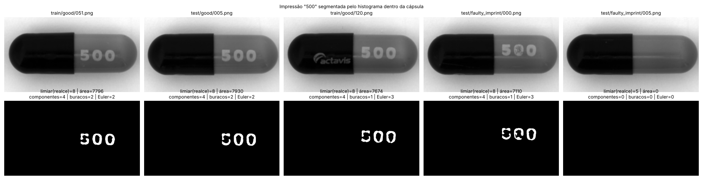
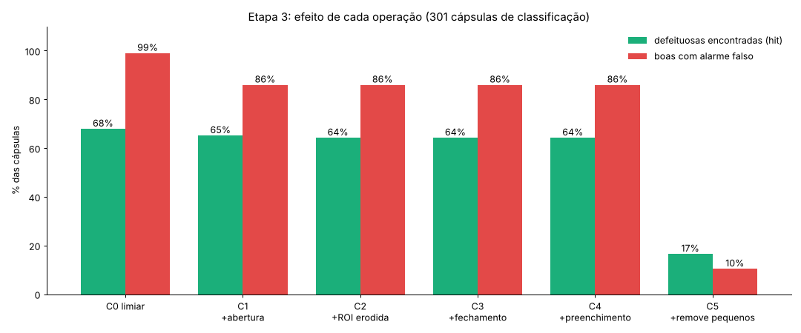
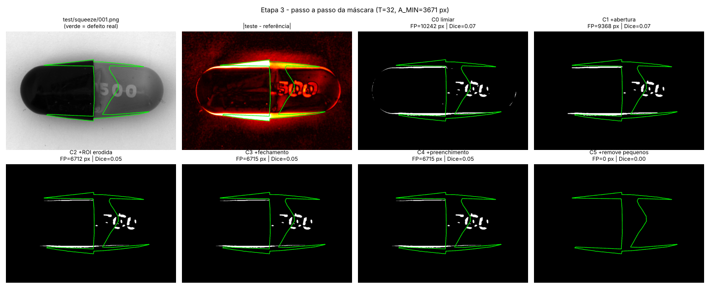
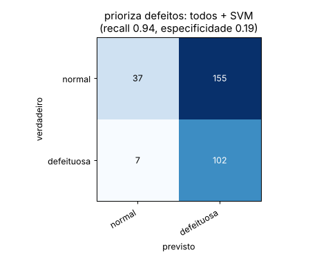
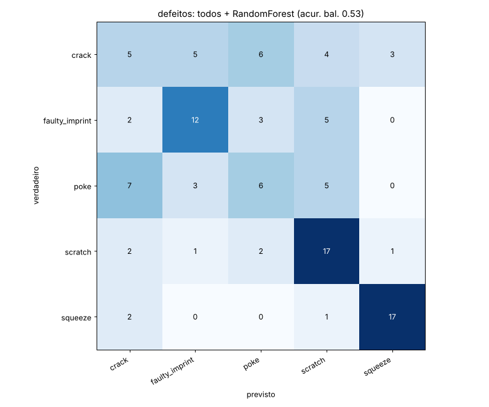
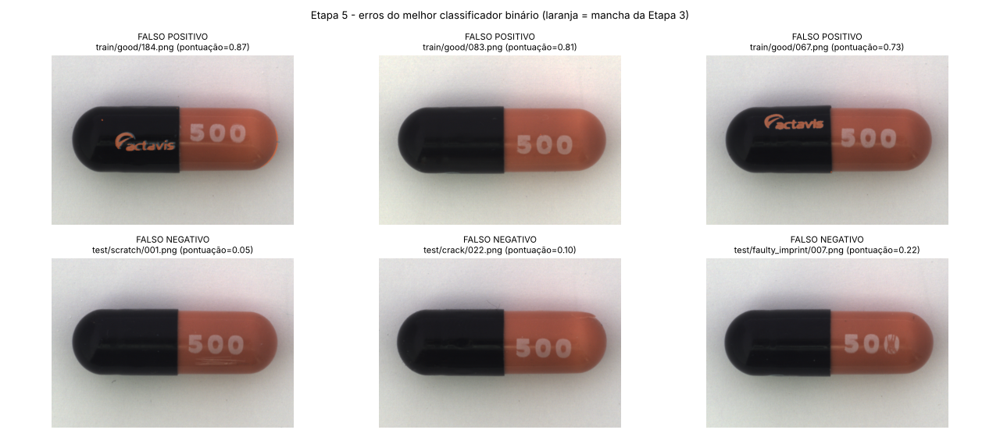

# Detecção e classificação de defeitos em cápsulas com processamento clássico de imagens

**Projeto 4 — Processamento Digital de Imagens (UFSCar) · Prof. Dr. Ricardo J. Ferrari**
Daniel e Murilo · base MVTec AD, categoria *capsule* · código em `src/`, resultados em `resultados/`

> Uso didático: partição própria; os números não são benchmark oficial do MVTec AD.

## Resumo

Investigamos se é possível detectar e classificar defeitos industriais usando apenas
processamento clássico de imagens e atributos interpretáveis. Na categoria *capsule* do MVTec AD,
comparamos duas estratégias de localização: bordas (Canny/Sobel) com morfologia, e diferença em
relação a uma cápsula boa de referência (*golden template*). O *golden template* venceu. Ele foi
aprimorado com a segmentação da impressão "500" e do logo pelo histograma e com o realinhamento
local dessas regiões. Em seguida, medimos o efeito de cada operação morfológica sobre os falsos
positivos, descrevemos a mancha mais suspeita de cada cápsula por 30 atributos (forma, textura,
posição/impressão) e classificamos com SVM e Random Forest em validação cruzada de 5 folds, sem
escolher parâmetros no conjunto de avaliação.

Resultados principais:
- a localização encontra **64%** das cápsulas defeituosas (Dice médio 0,155);
- a decisão normal × defeituosa atinge acurácia balanceada **0,70** (ROC-AUC 0,75);
- priorizando os defeitos, **94%** das defeituosas são encontradas, mas só 19% das boas são
  aprovadas;
- o tipo de defeito é identificado com acurácia balanceada **0,58** (acaso: 0,20).

A resposta à questão de projeto é **parcialmente sim**: defeitos grandes ou que alteram a impressão
são bem tratados, mas a localização é o gargalo. Arranhões finos quase não geram mancha, e a
variação natural da cápsula boa (rotação do logo, reflexos, contorno) gera manchas parecidas com
defeitos pequenos.

## 1. Problema e questão de projeto

O objetivo é simular a inspeção visual automática de uma linha de produção. A partir da foto de uma
cápsula, o sistema deve **localizar** regiões anômalas, **descrevê-las** por atributos clássicos e
**classificar** a cápsula como normal/defeituosa e pelo tipo de defeito. A questão de projeto do
enunciado é:

> *É possível detectar e classificar defeitos usando apenas processamento clássico e atributos
> interpretáveis?*

Todas as técnicas de imagem usadas foram vistas em aula (filtros, Otsu, morfologia, bordas,
template matching, componentes conexos, descritores de forma, de histograma e LBP). Os
classificadores (SVM e Random Forest) e as métricas são os pedidos no enunciado. O alinhamento
global por ECC, herdado da primeira versão, é a exceção, declarada na seção 8.

## 2. Dados e partição

**Base:** MVTec AD, *capsule*. São imagens RGB de 1000×1000 px de uma cápsula preta/laranja com a
impressão "500" e o logo "actavis", sobre fundo claro.
- `train/good`: 219 normais;
- `test/good`: 23 normais;
- `test/<defeito>`: 109 defeituosas, sendo *crack* 23, *faulty_imprint* 22, *poke* 21, *scratch*
  23 e *squeeze* 20;
- cada defeituosa tem uma máscara de referência (*ground truth*).

**Partição própria** (`src/particao.py` → `dados/particao.csv`, semente 42):

| Conjunto | Imagens | Uso |
|---|---|---|
| `banco` | 30 normais (`train/good` 000–029) | referências do *golden template* |
| `calibracao` | 20 normais (`train/good` 030–049) | calibrar limiares e tamanhos, usando só a variação normal |
| `classificacao` | 192 normais + 109 defeituosas | avaliação da localização; atributos e classificação em validação cruzada de 5 folds estratificados por tipo |

Regra adotada: **quem ajusta não dá nota**. Nenhum limiar ou tamanho é escolhido olhando o conjunto
`classificacao`, e os hiperparâmetros dos classificadores são ajustados só no treino de cada rodada.

## 3. Pipeline

```
imagem → cinza + bilateral → cápsula (Otsu) → golden template + realinhamento do "500"/logo
       → limiar calibrado → morfologia → manchas → ficha de 30 atributos → SVM / Random Forest
```

### 3.1 Pré-processamento e região de interesse
- Conversão para tons de cinza e **filtro bilateral** (d = 9, σ_cor = 40, σ_espaço = 9). Ele remove
  o ruído preservando o degrau dos defeitos finos; o Gaussiano espalharia o degrau, e a mediana
  apaga estruturas finas.
- **ROI da cápsula:** Otsu invertido (a cápsula é mais escura que o fundo), fechamento 15×15, maior
  componente conexo e erosão de 9 px para excluir o contorno, que acende por desalinhamento.

### 3.2 Localização: duas estratégias (Etapa 1)
- **A — bordas + morfologia:** Canny (15/40, histerese) e Sobel (|G| > 60), seguidos de abertura
  de 3 a 9 px.
- **B — golden template:** entre as 30 cápsulas do banco, escolhe-se a mais parecida com a testada
  (após o alinhamento global); a diferença |teste − referência| marca o que é anômalo.

### 3.3 Impressão e logo pelo histograma
Dentro da máscara da cápsula, o histograma tem modos separados: metade preta (< 45), logo (45–75),
metade laranja (75–112) e impressão (> 112). Como a iluminação deixa a metade laranja com dois tons,
o limiar é calculado no histograma do **realce local** (cinza − mediana 45×45), por Otsu: na metade
clara para o "500", na metade escura para o logo (com um contraste mínimo, porque o logo pode não
estar visível). Seguem abertura e componentes conexos com formato de algarismo ou letra
(`resultados/etapa4/impressao_500.png`).



### 3.4 Golden template com realinhamento local (Etapa 3)
A cápsula gira em torno do próprio eixo. Por isso, mesmo depois do alinhamento global, o "500" e o
logo aparecem alguns pixels deslocados em relação à referência. Na região dessas máscaras (no teste
e na referência), o deslocamento local é estimado por **template matching** (busca de ±20 px) e a
diferença é recalculada com a referência deslocada. A variação de posição desaparece, e uma falha
de impressão continua visível, porque altera a forma.

O **limiar** é o percentil 99 da diferença entre cápsulas boas (`calibracao` × `banco`): T = 27.

### 3.5 Morfologia (Etapa 3)
As operações são aplicadas de forma cumulativa, para medir o efeito de cada uma:
- C0: limiar;
- C1: abertura 5×5;
- C2: ROI erodida 9 px;
- C3: fechamento 5×5;
- C4: preenchimento de buracos;
- C5: remoção de componentes menores que A_MIN, com A_MIN = p95 da maior mancha nas boas de
  calibração (2.450 px).

A máscara **C4** segue para a etapa de atributos (justificativa na seção 5.2).

### 3.6 Atributos (Etapa 4)
Cada mancha com metade ou mais da área sobre o "500" ou o logo é tratada como variação normal. A
**mancha principal** é a maior entre as demais, ou seja, a mais suspeita. A ficha tem 30 atributos
em três grupos:

| Grupo | Atributos |
|---|---|
| Forma | nº de manchas, nº e área das suspeitas, área, perímetro, compacidade (P²/4πA), excentricidade, extensão, solidez, momentos de Hu 1–3 |
| Textura | média e desvio do cinza, média e máximo da diferença ao modelo, suavidade, assimetria, uniformidade e entropia do histograma, entropia e uniformidade do LBP |
| Posição e impressão | fração na metade preta, distância ao contorno, área de mancha sobre o "500" e sobre o logo, área relativa do "500", nº de componentes e de buracos do "500", variação de área entre algarismos |

### 3.7 Classificação (Etapa 5)
- **Tarefas:**
  - normal × defeituosa, nas 301 imagens;
  - qual defeito, nas 109 defeituosas.
- **Classificadores:** SVM (núcleo RBF, atributos padronizados) e Random Forest (300 árvores), com
  `class_weight='balanced'`. Hiperparâmetros por busca em grade com validação interna de 3 partes,
  dentro do treino de cada fold.
- **Ponto de operação "prioriza defeitos":** o limiar sobre a pontuação "defeituosa" é escolhido no
  treino de cada fold como o maior que ainda encontra ≥ 90% das defeituosas do treino.

## 4. Experimentos realizados (enunciado × onde está)

| Experimento mínimo | Onde |
|---|---|
| Comparar duas estratégias de localização | 5.1 (bordas × golden template) |
| Quantificar o efeito da morfologia sobre falsos positivos | 5.2 |
| Comparar atributos geométricos, de textura e a combinação completa | 5.4 (forma, textura, posição/impressão, todos) |
| Comparar pelo menos dois classificadores | 5.4 (SVM × Random Forest) |
| Separar resultados por tipo de defeito | 5.3 e 5.4 |
| Segmentação: Dice, IoU, precisão e recall pixel a pixel | 5.1 a 5.3 |
| Classificação: F1, acurácia balanceada, ROC-AUC | 5.4 |
| Exemplos de falsos positivos e falsos negativos | 6 |
| Etapas que mais limitam o desempenho | 7 |

A extensão opcional (atributos só da região defeituosa × atributos globais) não foi realizada.

## 5. Resultados

### 5.1 Bordas × golden template (Etapa 1, nas 132 imagens de `test/`)

Métricas:
- **hit:** fração de defeituosas com ≥ 30 px marcados dentro do *ground truth*;
- **FP/boa:** pixels marcados por cápsula boa;
- **precisão:** pixel a pixel.

| Estratégia | hit | FP/boa | Precisão |
|---|---:|---:|---:|
| Canny 15/40, sem abertura | 0,72 | 2.476 | 0,09 |
| Canny 15/40, abertura 3 | 0,42 | 247 | 0,24 |
| Canny 15/40, abertura 9 | 0,02 | 0 | 0,70 |
| **Golden template, limiar 30, abertura 5** | **0,63** | 2.792 | **0,31** |

As bordas não separam defeito de estrutura normal: a cápsula boa já é cheia de bordas (impressão,
logo, divisão das metades, contorno). A abertura que apaga essas bordas apaga os defeitos na mesma
proporção, porque rachaduras e arranhões também são finos. O golden template marca a **região** do
defeito, com precisão três vezes maior, e foi a estratégia adotada. (Nesta etapa, parâmetros e
avaliação usaram o mesmo `test/`; isso foi corrigido a partir da partição própria.)

### 5.2 Efeito da morfologia e do realinhamento (Etapa 3, 301 imagens de `classificacao`)

| Etapa (cumulativa) | hit | FP px/boa | Boas com alarme | Precisão | Dice | IoU |
|---|---:|---:|---:|---:|---:|---:|
| C0 limiar | 0,68 | 2.416 | 99% | 0,31 | 0,155 | 0,101 |
| C1 + abertura 5 | 0,65 | 1.905 | 86% | 0,34 | 0,159 | 0,106 |
| C2 + ROI erodida | 0,64 | 1.832 | 86% | 0,34 | 0,155 | 0,103 |
| C3 + fechamento | 0,64 | 1.856 | 86% | 0,34 | 0,156 | 0,104 |
| **C4 + preenchimento** | **0,64** | **1.913** | **86%** | **0,34** | **0,155** | **0,104** |
| C5 + remove < 2.450 px | 0,17 | 568 | 10% | 0,45 | 0,058 | 0,042 |



- A **abertura** é a operação que mais reduz falsos positivos (boas com alarme: 99% → 86%). ROI
  erodida, fechamento e preenchimento quase não mudam os números, mas deixam as manchas sólidas
  para a descrição.
- A **remoção por área** elimina quase todos os alarmes e quase todos os defeitos: as manchas falsas
  das boas têm o tamanho dos defeitos. Por isso seguimos com **C4**.
- O **realinhamento local do "500" e do logo** reduziu a variação normal (o limiar calibrado caiu de
  32 para 27) e melhorou a localização:

| Máscara C4 | hit | FP px/boa | Dice | hit *crack* | hit *faulty_imprint* |
|---|---:|---:|---:|---:|---:|
| sem realinhamento | 0,57 | 2.398 | 0,126 | 0,65 | 0,59 |
| com realinhamento | **0,64** | **1.913** | **0,155** | **0,83** | **0,82** |

### 5.3 Localização por tipo de defeito (máscara final C4)

| Tipo | hit | Precisão | Recall | Dice | IoU |
|---|---:|---:|---:|---:|---:|
| *crack* | 0,83 | 0,51 | 0,22 | 0,246 | 0,176 |
| *faulty_imprint* | 0,82 | 0,14 | 0,08 | 0,082 | 0,044 |
| *poke* | 0,67 | 0,44 | 0,18 | 0,229 | 0,161 |
| *scratch* | 0,00 | 0,00 | 0,00 | 0,000 | 0,000 |
| *squeeze* | 0,95 | 0,40 | 0,25 | 0,233 | 0,145 |

As manchas são parciais (recall pixel a pixel ≤ 0,25): o método marca pedaços do defeito (bordas
do *poke*, extremidades do *squeeze*), o que basta para "achar" a cápsula, mas não para delinear o
defeito. O *scratch* é fino e de baixo contraste demais para a diferença ao modelo.



### 5.4 Classificação (Etapa 5)

**Normal × defeituosa** (301 imagens; acaso: acurácia balanceada 0,50):

| Grupo | SVM: acur. bal. / F1 / AUC | Random Forest: acur. bal. / F1 / AUC |
|---|---|---|
| forma | 0,59 / 0,33 / 0,64 | 0,64 / 0,53 / 0,65 |
| textura | 0,58 / 0,45 / 0,65 | 0,59 / 0,45 / 0,63 |
| posição/impressão | 0,66 / 0,55 / 0,69 | 0,70 / 0,60 / 0,74 |
| **todos** | **0,70 / 0,60 / 0,75** | 0,70 / 0,60 / 0,75 |

Com a decisão padrão (todos + RF): precisão 0,70, recall 0,52, especificidade 0,87.

**Priorizando os defeitos** (limiar escolhido no treino para recall ≥ 90%):

| Grupo | SVM: recall / especificidade | Random Forest: recall / especificidade |
|---|---|---|
| forma | 0,91 / 0,13 | 0,94 / 0,06 |
| textura | 0,92 / 0,21 | 0,95 / 0,12 |
| posição/impressão | 0,92 / 0,18 | 0,94 / 0,18 |
| **todos** | **0,94 / 0,19** | 0,94 / 0,19 |

Todos + SVM encontra 102 das 109 defeituosas (*crack* 21/23, *faulty_imprint* 22/22, *poke* 19/21,
*scratch* 21/23, *squeeze* 19/20), aprovando 37 das 192 boas.



**Qual defeito** (109 defeituosas; acaso: 0,20):

| Grupo | SVM: acur. bal. / F1 macro | Random Forest: acur. bal. / F1 macro |
|---|---|---|
| forma | 0,39 / 0,39 | 0,38 / 0,38 |
| textura | 0,53 / 0,53 | 0,45 / 0,43 |
| posição/impressão | 0,33 / 0,34 | 0,50 / 0,49 |
| **todos** | 0,55 / 0,54 | **0,58 / 0,57** |

Acerto por tipo (todos + RF): *squeeze* 0,90, *faulty_imprint* 0,86, *crack* 0,43, *scratch*
0,43, *poke* 0,29.



- **A combinação completa** é a melhor nas duas tarefas. Nenhum grupo sozinho chega lá.
- Na decisão normal × defeituosa, o grupo **posição/impressão** sozinho chega perto do total; para
  o tipo, **textura** e **forma** pesam mais. Os atributos mais usados pelo Random Forest são área e
  perímetro da mancha suspeita, área relativa do "500", diferença média ao modelo e variação de área
  entre algarismos (`importancia_atributos.png`).
- **SVM × Random Forest:** desempenho equivalente na decisão normal × defeituosa; o Random Forest é
  melhor para o tipo de defeito.

## 6. Exemplos de erros



- **Falsos positivos** (boas rejeitadas): manchas sobre o logo **parcialmente visível** (quando a
  cápsula gira, o logo aparece cortado e o realinhamento não reproduz a forma), reflexos e contorno.
  Em algumas, a mancha é mínima e a decisão vem dos atributos da impressão.
- **Falsos negativos** (defeituosas aprovadas): defeitos que viraram **manchas pequenas**: rachadura
  e furinho com poucos pixels marcados, e *squeeze* cuja deformação fica na faixa da borda excluída
  pela ROI erodida.
- A lista completa de erros está em `resultados/etapa5/erros_binaria.csv`.

## 7. Discussão: o que mais limita o desempenho

1. **Localização (parte 1) é o gargalo principal.** A classificação só reconhece o que a localização
   marcou. Melhorar a localização (hit 0,57 → 0,64) aumentou o acerto do tipo (0,53 → 0,58), mas não
   a decisão normal × defeituosa, que ficou em ≈ 0,70 em todas as versões. Mesmo após o
   realinhamento, ≈ 75% das cápsulas boas ainda têm alguma mancha suspeita fora do "500" e do logo,
   parecida com as manchas pequenas de rachaduras e arranhões.
2. **Variação natural da cápsula boa.** A rotação em torno do próprio eixo muda a posição do "500"
   e a visibilidade do logo. Nenhuma transformação 2D global corrige isso. O realinhamento local
   resolveu quase todo o problema do "500" (≈ 3% dos pixels falsos restantes), mas não o do logo
   parcialmente visível (≈ 76%).
3. **Defeitos finos e de baixo contraste.** O *scratch* tem Dice ≈ 0 em todas as versões: a
   diferença que ele causa está abaixo da variação normal medida na calibração.
4. **Trade-off precisão × recall.** Achar ≥ 90% dos defeitos custa rejeitar ~80% das boas. Com a
   decisão padrão, aprova-se 87% das boas, mas só metade dos defeitos é encontrada.
5. **Poucos exemplos por classe** (~20 por defeito): diferenças de até ±0,05 entre configurações
   estão dentro da variação esperada.

## 8. Limitações e escolhas declaradas

- **ECC:** o alinhamento global usa ECC (modelo euclidiano), que não foi visto em aula. O
  realinhamento local usa template matching.
- **Etapa 1:** parâmetros e avaliação no mesmo `test/` (corrigido a partir da Etapa 2).
- **Escolhas feitas depois de ver resultados no conjunto `classificacao`**, cada uma rodada uma
  única vez:
  - usar C4 em vez de C5;
  - acrescentar o realinhamento do "500"/logo;
  - descrever a mancha principal fora do "500"/logo.

  As duas últimas foram motivadas por diagnóstico (onde estavam os pixels falsos). Ainda assim, os
  números finais podem estar levemente otimistas.
- **GLCM** (citada no enunciado) não foi usada, porque não foi vista em aula. A textura é descrita
  por estatísticas do histograma e LBP.
- Avaliação **didática**, em partição própria; não é benchmark oficial do MVTec AD.

## 9. Conclusão

É possível detectar e classificar **parte** dos defeitos de cápsulas apenas com processamento
clássico e atributos interpretáveis:
- defeitos grandes ou que alteram a impressão (*squeeze*, *faulty_imprint*) são localizados e
  identificados com acerto de 86% a 90%;
- priorizando os defeitos, o sistema encontra 94% das cápsulas defeituosas.

O limite está na **localização**: a variação natural da cápsula boa (rotação do logo, reflexos,
contorno) produz manchas tão grandes quanto defeitos pequenos, e arranhões finos ficam abaixo dessa
variação. Por isso, achar quase todos os defeitos custa rejeitar a maior parte das cápsulas boas. O
caminho mais promissor é tratar as regiões variáveis restantes (logo parcialmente visível,
contorno, reflexos) com a mesma estratégia usada no "500": segmentar e comparar de forma específica,
em vez de subtrair diretamente.

## Referências

- Bergmann, P. et al. *MVTec AD — A Comprehensive Real-World Dataset for Unsupervised Anomaly
  Detection.* CVPR, 2019.
- Otsu, N. *A Threshold Selection Method from Gray-Level Histograms.* IEEE Trans. SMC, 1979.
- Canny, J. *A Computational Approach to Edge Detection.* IEEE Trans. PAMI, 1986.
- Tomasi, C.; Manduchi, R. *Bilateral Filtering for Gray and Color Images.* ICCV, 1998.
- Ojala, T.; Pietikäinen, M.; Mäenpää, T. *Multiresolution Gray-Scale and Rotation Invariant
  Texture Classification with Local Binary Patterns.* IEEE Trans. PAMI, 2002.
- Hu, M.-K. *Visual Pattern Recognition by Moment Invariants.* IRE Trans. Information Theory, 1962.
- Cortes, C.; Vapnik, V. *Support-Vector Networks.* Machine Learning, 1995.
- Breiman, L. *Random Forests.* Machine Learning, 2001.
- Gonzalez, R. C.; Woods, R. E. *Processamento Digital de Imagens.* Pearson.
